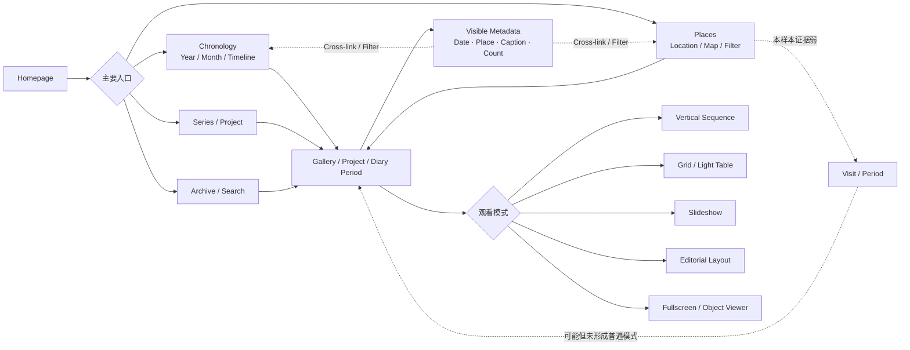

# 个人摄影档案与摄影师网站呈现方式：深度案例研究

## 执行摘要与研究方法

本轮研究围绕一个非常具体的目标展开：不是寻找“最好看的摄影 Portfolio”，而是寻找能够帮助理解**长期个人摄影档案如何在时间、地点、Gallery、重复访问和作品观看之间建立稳定关系**的真实案例。研究字段、优先级与反例要求遵循本轮提供的完整 Research Brief。fileciteturn0file0

本次最终纳入 **29 个有效案例**，覆盖个人 Visual Diary、长期摄影 Archive、艺术摄影师官方网站、摄影项目/摄影书式网站、机构摄影档案与数字展览档案。判断尽可能基于摄影师本人网站或机构官方页面，而不是“Best Photography Websites”类聚合文章。

全文使用以下标记：

- **Observed / O**：可以由当前实际页面或官方文字直接确认。
- **Interpretation / I**：根据页面结构作出的 UX / IA 解读，不等同于网站作者的设计意图。
- **Research implication / R**：对后续 Stage 2 值得保留的问题或启示；**不是本轮最终设计方案**。

### 核心发现

**第一，真正同时把 Chronology 与 Places 做成平等、可操作浏览维度的个人摄影网站非常少。** Germán Sáez 是本样本中最接近这一模型的个人站点：Archive 同时提供 publication year、location、camera、film 等 facets，而 `Paris` 是一个持续存在的 location landing page，聚合了 1999、2005、2015、2016、2017、2022 等不同年份拍摄的照片。citeturn17search0turn17search1turn17search5 Eric Escapes 则把 `Index · by place` 直接放到首页核心位置，但同时混用了 Sydney、Japan、Vietnam、Austria、Italy、Hong Kong 等不同地理粒度。citeturn17search13

**第二，成熟摄影师网站更普遍的做法不是建立 Place Entity，而是把 Project / Series 作为第一组织原则。** Rinko Kawauchi 的 Works 以 `M/E 2022`、`Halo 2017`、`Ametsuchi 2013` 等项目组织；Alec Soth 的 *Sleeping by the Mississippi* 把 Winona、Minneapolis、New Orleans、Memphis 等地点放在单张照片 caption 中；Mark Power 则用带年份的项目清单组织 1985–2024 的工作。citeturn19search0turn19search3turn15search14 这意味着“地点作为永久节点”并不是成熟艺术摄影网站的默认答案。

**第三，本样本没有找到一个成熟个人摄影站点明确、稳定地把 `Visit` 作为独立一级内容实体公开给用户。** 反而有相当强的相反证据：Mark Power 的 *Dome* 明确经历了 **100 多次**前往 North Greenwich 的拍摄，却全部被折叠进一个 Project；*The Sound of Two Songs* 在五年间又进行了约 **20 次**波兰访问，同样仍是一个 Project，而不是 20 个 Visit。citeturn20search4turn15search16 因而，目前证据并不能证明 `Place → Visit → Gallery` 中的 Visit 必须成为用户可见 IA 层。

**第四，Chronology 的实用性证据明显强于 Visit，但它也并不一定要成为一级导航。** Daniel Pietzsch、Hans Zappe、Scott Morris、Fotogalerie Friedrichshain、Fortepan 等把时间明确暴露出来；Rinko Kawauchi、Alec Soth、Vanessa Winship 等优秀网站则让时间退化为作品年份或 caption metadata。citeturn16search5turn16search1turn16search0turn24search2turn19search0turn19search3turn20search14 两组证据都成立：前者解决“档案发现”，后者保护“作品作为作品”的完整性。

**第五，没有证据支持统一的“最佳 Gallery 照片数量”。** 在真实案例中，可见内容单元跨度从约 20 张到数百张：Gerry Johansson 的一些作品以完整摄影书序列呈现；Simon Roberts 的项目包括 25 张的 *Election Project*、56 张的 *A Daily Sea*、56 张的 *We English*、81 张的 *Pierdom* 和 163 张的 *Shipping Forecast*；Furuya 的明确 work units 有 75 和 99 张；Daniel Pietzsch 的月度日记则从个位数一路达到 239 张。citeturn15search10turn19search2turn15search11turn19search4turn20search7turn22view0turn16search5 因此 Gallery 粒度更像是**编辑逻辑问题，而不是数字阈值问题**。

**第六，地图最成熟的证据来自大型机构/社区 Archive，而不是个人摄影师网站。** Photogrammar 以 location + time + photographer 的地图作为核心发现界面；Fortepan 把 timeline、location/search、地图、对象详情、slideshow/fullscreen 结合起来。citeturn23search1turn23search12turn14search5 它们证明地图在十万级数据集上能承担 navigation，但并不能直接证明地图适合一个强调 sequencing 的个人摄影档案。

**第七，About 可以非常弱。** Scott Morris 的 About 实际只有姓名与“Details to follow”；Eric Escapes 首页几乎完全由地点 Archive 与最新 diary 建立身份；Germán Sáez 的 Profile 与 Archive 并列，但 Archive 本身承担了大量身份表达。citeturn16search9turn17search13turn17search1 与之相反，Simon Roberts、Cherry Adam 等仍使用较完整 Biography / CV / artist context，同样没有妨碍作品成为主体。citeturn15search4turn18search19

**第八，Mobile 是本研究最大的证据空白之一。** 除 LESLIN 页面明确暴露“移动指针 / 触摸字母 · Move / Touch”外，大多数站点从公开 HTML 内容无法可靠确认 swipe、手机 lightbox、横图尺寸、lazy loading、keyboard-to-touch 映射等行为。citeturn18search4 因此下表中绝大多数移动端项严格标记为 **Unknown / Unable to verify**，没有根据桌面站点进行猜测。

## 案例数据集

### 基础元数据与信息架构

“年份范围”只记录当前网站可验证范围，不推断摄影师完整职业生涯；“地点”是作品/站点相关地点，而不一定代表摄影师居住地。

| ID | 作者 / 站点 | 类型 | 可验证年份范围 | 城市 / 地点 | 系列 / Project | Primary organization | URL | 相关度 |
|---|---|---|---|---|---|---|---|---|
| C01 | **Germán Sáez — Archive** | Personal Archive / Portfolio | 网站始于 2001；公开按年份 Archive 2008–2026；照片可更早 | Paris、Berlin、Tokyo、New York 等 | Portfolio Series + 单张 Archive | **Mixed：Year + Location + metadata facets** | [Archive](https://germansaez.com/archive/) | **High**。Archive 明确支持 year、location、camera、film 等；Paris 单地点页聚合 415 张跨年份照片。citeturn17search0turn17search1 |
| C02 | **Daniel Pietzsch’s Photo Journal** | Visual Diary / Personal documentary | 当前可验证至少 2016–2026 | Düsseldorf 为长期生活核心，另有 Berlin、Norway、Stockholm 等旅行 | 月度 / 多月 diary post | **Chronology** | [Photo Journal](https://photojournal.danielpietzsch.com/) | **High**。Year → Month 是明确架构，月度单元同时显示照片数和发布日期。citeturn16search5 |
| C03 | **Domenic Driessen — Visual Diary** | Visual Diary + Commercial Portfolio | before 2022–2025 可见 | Hamburg；Marseille、Athens、Arles、Berlin、Mexico 等 | Diary sections + commissioned projects | **Chronology / Project mixed** | [Visual Diary](https://domenicdriessen.com/visual-diary/) | **High**。时间 anchor 与地点标题直接混合在一个持续影像流里。citeturn16search2 |
| C04 | **Hans Zappe Photography** | Personal Portfolio / Archive | 2004–2025 | Torino 等；整体地点体系未说明 | 年度 Archive | **Year** | [Portfolio](https://hanszappe.ch/home/portfolio/) | **Medium**。非常清楚的纯 Year Archive 对照组。citeturn16search1 |
| C05 | **Scott Morris Photography** | Personal Archive | 2006–2022，可见年份中无 2008 | 未说明 | 每年精选 | **Year** | [Archive](https://scomo.photo/archive/) | **Medium**。Archive 只提供年度入口；About 几乎为空。citeturn16search0turn16search9 |
| C06 | **Eric Escapes** | Personal Visual Archive / Diary | 2026 diary 可验证；Place 内容整体年份未说明 | Sydney、Japan、Vietnam、Austria、Italy、Hong Kong | Place collection + diary | **Place first** | [Visual Archive](https://www.ericescapes.com/) | **High**。首页直接标为 `Index · by place`，六个地点共 274 frames。citeturn17search13 |
| C07 | **StatKant** | Visual Diary / Evolving Archive | 2019–2026 | Athens-based；travel routes / urban spaces | 未明确验证具体 Gallery 层级 | **Mixed / actual navigation Unknown** | [About](https://statkant.com/about-statkant-com/) | **Medium**。站点明确自我定义为非商业 photographic visual archive，但实际浏览 IA 尚不足以完整验证。citeturn17search14 |
| C08 | **Lique Schoot — LS diaries** | Long-term Visual Diary | 2003–ongoing | 地点非核心 | 每日 1 张；另编辑成多个 series | **Daily chronology → derived series** | [Photography](https://liqueschoot.eu/photography/) | **High**。超过 8,000 张，每张以 YYYY-MM-DD 命名。citeturn17search12turn17search15 |
| C09 | **José Bértolo — 365 / Year of Maria** | Visual Diary / Photographic project | 2022–2025 | Lisbon、Porto、Espinho 等 | 365 / 399-day projects | **Chronology / Project** | [365](https://www.josebertolo.com/bertolo-365) | **High**。项目边界由日期精确定义；新项目还在图片级显式标地点。citeturn18search0turn18search3 |
| C10 | **Nuno Palha — Continuous Visual Diary Archive** | Personal Visual Archive | ongoing；具体起始年未说明 | 未说明 | 未说明 | **Archive concept；actual IA Unknown** | [Home](https://www.nunopalha.com/) | **Medium**。首页明确以 “A Continuous Visual Diary Archive” 定义项目。citeturn18search2 |
| C11 | **Cherry Adam** | Visual Diary / Photojournalism / Series | 可见 2023–2026 | Berlin；作者 Caracas / Berlin | Windows、事件 reportage、Visual Diary 等 | **Category / Series** | [Home](https://cherryadam.com/) | **Medium–High**。Berlin 事件跨 2024–2026 不断新增，但不建立 Berlin Place page。citeturn18search1turn18search12 |
| C12 | **LESLIN — 小L的摄影日记** | Visual Diary / Journal | 当前站点 2026；拍摄年份未统一说明 | Rome、Guangxi、Shenyang 等 | Featured Works + Journal | **Category / Project** | [LESLIN](https://leslinspace.com/) | **Medium–High**。明确弱化虚构履历，重点是作品、城市/旅行类别与拍摄笔记。citeturn18search4 |
| C13 | **Rinko Kawauchi — Works** | Artist Portfolio / Series Archive | Works 可见 2001–2022；出版延续至 2025 | Iceland、Hokkaido 等在项目文本内出现 | 明确 Series / Works | **Project first** | [Works](https://rinkokawauchi.com/en/works/) | **High，作为反例**。作品按项目标题+年份，而非 Place / Timeline。citeturn19search0turn19search5 |
| C14 | **Alec Soth — Photography Projects** | Artist Project Archive | *Sleeping by the Mississippi* 可验证 1999–2002；站点整体更广 | Mississippi corridor、MN、New Orleans、Memphis 等 | Project / Book | **Project first** | [Sleeping by the Mississippi](https://alecsoth.com/photography/projects/sleeping-by-the-mississippi/) | **High，作为 sequencing 反例**。地点与年份放在照片 caption 中而不是地理 IA。citeturn19search3 |
| C15 | **Martin Parr** | Photographer site / Blog Archive / Projects | Tearsheets 选择从 1976 起；Archive 跨多年 | Nice、UK 及全球 | Project + dated site archive | **Project + chronology** | [Site](https://martinparr.com/) | **Medium**。年份 Archive 有用，但混入新闻、展览、博客内容，属于 CMS chronology 而非纯作品 Archive。citeturn2search7turn2search14 |
| C16 | **Simon Roberts** | Artist Project Archive / Digital publication | 可验证项目至少 2004–2024 | Britain、Brighton、Russia、Italy、Normandy 等 | 强 Project / Series | **Project first** | [Work](https://www.simoncroberts.com/work/) | **High**。多个项目明确公开照片数量、持续时间、contact sheet，适合研究 Gallery granularity。citeturn19search2turn19search4turn15search13 |
| C17 | **Gerry Johansson** | Artist / Photobook Archive | 官网出版物 1980–2025 | Sweden、Germany、USA、Tokyo、Paris 等 | Book / geographic project | **Book / Project** | [Books](https://www.gerryjohansson.com/styled/index.html) | **High–Medium**。大量作品本身以地点命名，但地点仍是摄影书/Project，而不是 Place taxonomy。citeturn20search15turn20search18 |
| C18 | **Seiichi Furuya** | Artist Archive / Works / Exhibitions | 页面照片从 1970 到 2007 等；作品持续后期重编辑 | Graz、East Berlin、Dresden、Tokyo、Istanbul 等 | Works / Exhibition / re-editing | **Project first + location/date metadata** | [Homepage](https://www.furuya.at/en/home.html) | **High**。Graz 在大量年份反复出现，但没有统一 Graz node；Repeated Place 证据非常强。citeturn22view0 |
| C19 | **Vanessa Winship** | Artist Project Portfolio | 出版可验证 2007–2019；项目拍摄期未统一列出 | Black Sea、Georgia、Balkans、USA 等 | Project / Series | **Project first** | [Site](https://www.vanessawinship.com/) | **High–Medium**。明确提供 slideshow / light table 两种 Gallery 观看方式。citeturn20search14turn20search19 |
| C20 | **Mark Power** | Long-term Artist Project Archive | Projects 1985–2024 | London、Berlin、Poland、USA、Korea 等 | Projects with explicit year/range | **Reverse-chronological project index** | [Projects](https://www.markpower.co.uk/Projects) | **High**。长期、多次访问经常被折叠进一个 Project，而不是 Visit hierarchy。citeturn15search14turn20search4 |
| C21 | **Joel Meyerowitz** | Selected Works / Portfolio | Selected / retrospective 可验证 1962–2022 | New York、Cape Cod、St. Louis 等 | Theme / Series | **Series / Theme** | [Selected Works](https://www.joelmeyerowitz.com/) | **Medium**。强主题式选集，时间/地点并非 Archive 浏览轴。citeturn23search0turn23search13 |
| C22 | **Florian Merkel — photographic archive** | Long-term Personal Artist Archive | 1976–2018 | Berlin、Halle、East Germany 等 | Projects with years | **Project + year metadata** | [Archive](https://florianmerkel.com/) | **High–Medium**。长达数十年的项目清单直接暴露时间跨度，但不建立地理层级。citeturn23search5 |
| C23 | **Photogrammar** | Institutional Digital Photo Archive | 1935–1944 | United States | objects / lots / shooting strips | **Map + time + photographer + search** | [Photogrammar](https://photogrammar.org/) | **High for map/archive research**。170,000 张级规模，地图是核心 discovery interface。citeturn23search1turn23search15 |
| C24 | **International Center of Photography Collections** | Museum Collection Archive | earliest photography–contemporary | Global；大量 object-level location | Collection / object | **Collection / metadata** | [Collections](https://www.icp.org/collections) | **Medium**。超过 200,000 件打印及相关材料；对象页展示 Date、Location、medium 等。citeturn24search5turn24search27 |
| C25 | **Tokyo Digital Archive** | Government photographic archive | 1947–present | Tokyo | Theme collections + individual object | **Theme first; date metadata** | [Tokyo Digital Archive](https://www.koho.metro.tokyo.lg.jp/photo/en/tokyoarchive/index.html) | **High–Medium**。整座 Tokyo 本身是永久 geographic scope，但内部主要按主题而非访问组织。citeturn24search0turn24search11 |
| C26 | **The PhotoHouse Archive** | Historical Photography Archive | Jaffa 示例从 before 1914 至 1969；整体更广 | Jaffa、Tel-Aviv、Jerusalem 等 | Archive objects / collections | **Faceted: place + year + decade + theme** | [Archive](https://www.thephotohouse.co.il/en/collections/archive) | **High**。地点与年份是并行 filter，Jaffa 一页跨越数十年。citeturn24search8turn24search1 |
| C27 | **Fotogalerie Friedrichshain Archive** | Exhibition Archive | 1985–present | Berlin institution；展览地点/主题多样 | Exhibition | **Chronology** | [Archiv](https://fotogalerie.berlin/archiv/) | **Medium**。采用固定五年时间桶，再进入年度展览列表。citeturn24search2turn24search3 |
| C28 | **Fortepan** | Community / Institutional Photo Archive | 官网未给单一总拍摄范围；拥有 20 万+历史照片 | Budapest、Hungary 及其他地点 | Archive objects + curated series/blog | **Timeline + place/search + map** | [Fortepan](https://fortepan.hu/en/) | **High for archive scalability**。支持 object viewer、year/location metadata、slideshow、fullscreen。citeturn14search3turn14search5 |
| C29 | **Bob Eckert Photography Archive** | Personal Archive / Journal index | Archive entries 至少自 2019 起 | Santa Fe、Cumbres/Toltec 等 | dated additions | **Continuous chronology** | [Archive](https://www.bobeckertphotography.com/archive.html) | **Medium / anti-pattern reference**。长线性时间 Index 极简单，但缺少第二发现维度。citeturn1search5 |

### 逐案例结构与观看行为

`U` = **Unknown / Unable to verify**。Gallery 模式只在页面实际提供足够证据时描述；没有根据 HTML 顺序猜测手机端 swipe。

| ID | Chronology | Places | Repeated-place handling | Gallery / viewer | Archive / retrieval | About 权重 | Mobile |
|---|---|---|---|---|---|---|---|
| C01 | **强**：publication year 2008–2026；单图同时有 Taken 与 Published | **强**：Location facet | Paris 为永久 location page，跨年份照片直接合并；**无 Visit 层** | Archive entry → 单图详情；页面可按 facets 进入 | Year、category、location、camera、lens、film、model 等多维 | Low | **U** citeturn17search0turn17search1turn17search2 |
| C02 | **一级**：Year → Month / period | 地点在月度摘要和内容中 | Düsseldorf 2016–2024+不断出现在不同月份；**按月份，不按城市归并** | 每个 diary post 是大量照片的时间序列；页面显示照片数 | 年份与月份本身就是 Index | Low | **U** citeturn16search5 |
| C03 | 年 anchor + section year | section 标题直接使用 Marseille / Mexico / Athens 等 | 同地未来若重复，目前页面未见统一 Place node | 单页持续 Visual Diary stream；独立商业 project 页也为图文序列 | `before 2022 / 2022 / 2023 / 2024` anchor | High，因 clients/licensing/commercial 明显 | **U** citeturn16search2turn16search6 |
| C04 | **一级**：2004–2025 | 无结构化 Place index | U | 年度入口 | 纯年份目录 | U / Low | **U** citeturn16search1 |
| C05 | **一级**：年度 | 无 | U | 年度精选页面 | Year links | **Very low**：About 仅“Details to follow” | **U** citeturn16search0turn16search9 |
| C06 | 最新 diaries 有日期；Archive 本体不是 time-first | **一级：by place** | Sydney 是一个 aggregate bucket；未见 Visit/year 子层 | Place cover + frame count；具体 viewer 行为 U | 六个 Place index | **Very low** | **U** citeturn17search13 |
| C07 | 站点文字声明 2019–2026 | 概念上强调 places；实际导航 U | U | U | U | Medium–High：About 解释项目较长 | **U** citeturn17search14 |
| C08 | **每日级**，一张/天，YYYY-MM-DD | 非核心 | 长期生活被连续时间序列吸收，不建立 Place | 每日照片最终又可被编辑成 series | 时间本身就是 archival identifier | Medium | **U** citeturn17search12turn17search15 |
| C09 | **极强**：365 / 399-day calendar | *Year of Maria* 图片显示 Lisboa、Porto 等 | 同一 Lisbon 跨大量日期重复，但无 Lisbon hub | `Loading more` 的日期/地点 image items；另有 Daily 日期 stream | Project calendar / daily index | Medium | **U** citeturn18search3turn18search13 |
| C10 | U | U | U | U | 首页仅能确认 Continuous Visual Diary Archive 定位 | U | **U** citeturn18search2 |
| C11 | Series / event 日期明确 | 地点多通过 title/caption：Berlin | Berlin 的多个事件成为独立故事；**无统一 Berlin page** | Photojournalism galleries；部分单页为长图片组 | category / series | High：About + publications/exhibitions 较完整 | **U** citeturn18search12turn18search19 |
| C12 | 次要 | City / Travel 是 category；作品标题出现 Rome、Shenyang、Guangxi | U | Featured Work + Journal | 分类和 Journal | Low–Medium | 首页明确有 **Touch** 文案；具体 Gallery mobile U citeturn18search4turn18search22 |
| C13 | Project 年份作为 metadata | 无 Place index | 多地点可被同一 Project 吸收 | Work/project presentation；具体 lightbox U | Works list | Medium | **U** citeturn19search0turn19search5 |
| C14 | 项目/照片年份次要 | caption 中明确 city/state | 同一地区由 Project narrative 吸收 | 图片按作品顺序展示，location+year caption | Project index | Medium | **U** citeturn19search3 |
| C15 | Archive 有 Year / post date | 地点在具体项目/文章里 | 多次地点通常成为独立内容，而不是 Place hub | Blog/project image sequence | year-based CMS Archive + Projects | High | **U** citeturn2search14turn2search7 |
| C16 | Project date/range | place 是 Project 语义的重要组成，但没有 Place taxonomy | 长期国家/地区项目通常在一个 Project 内 | 项目页 + contact sheet / full sequence；多个明确数量级 | Project archive | High | **U** citeturn19search2turn19search4turn19search14 |
| C17 | Books 按出版年份 | 很多项目以地名命名 | 地点通过不同书籍/项目存在，不是统一 Place record | 部分书页提供 “all images in book” | Books / Exhibitions | Very low–Low | **U** citeturn20search15turn20search17turn20search18 |
| C18 | 照片 location+year；work production year 另列 | 地点 metadata 很明显 | **Graz 多年重复，但散布于不同 Works；无 Graz hub** | 首页明确为 **slides**，有 previous / next | Works / exhibitions via carousel links | Low | **U** citeturn22view0 |
| C19 | Project first，年份不是核心导航 | 项目地域性强 | 多次 Black Sea 等被项目/part 吸收 | **Go to Slide Show / Go to Light Table / Click to Enlarge** | project list | Medium | **U** citeturn20search14turn20search19 |
| C20 | **强**：Project list 自 2024 向 1985 排列，标题直接带 range | location 体现在 project | 多次访问折叠到单一 Project；London 不统一成 London page | Project page → Photographs；有项目明确按 chronology 分段 | Reverse-chronological Projects index | Medium | **U** citeturn15search14turn20search1 |
| C21 | 次要；Series/theme first | 无 Place index | 地点通过 `St. Louis`、`Cape Light` 等 series 表达 | Selected Works image pages | Theme / selected works | High（Bio / class / blog / events 等） | **U** citeturn23search0turn23search6 |
| C22 | 各项目直接标 year/range | 地点体现在项目标题 | 重复地点未统一汇总 | Project/image archive | 数十年项目文字 index | Very low–Low | **U** citeturn23search5 |
| C23 | **强**：年份可过滤；拍摄时间是核心 metadata | **强**：interactive map / county/location | 相同地点跨时间通过地图+时间筛选交叉发现；无 Visit | Map/search → object；另可查看约 40,000 图的 shooting order | Map + Search + Lot + Classification | N/A institution | **U** citeturn23search1turn23search12 |
| C24 | object-level Date | object-level Location | 相同地点可跨年代存在；Visit 无意义 | Collection → object | Curated collections + object records | N/A | **U** citeturn24search5turn24search27 |
| C25 | object 有月/年；另有年代专题 | Tokyo 是全站 permanent geographic scope | 同一城市数十年持续积累，但内部主要 theme-first | Theme → object → Related Archives | Theme collections | N/A | **U** citeturn24search0turn24search7turn24search13 |
| C26 | Year + Decade filter | **Location filter** | **Jaffa 聚合 before 1914、1936、1956、1969 等** | Thumbnail/item list | Search + Theme + Area + Decade + Format + Location + Year | N/A | **U** citeturn24search1turn24search8 |
| C27 | **一级**：5-year buckets → year | 地点不是 archive axis | 不适用 | Exhibition lists | 1985–89、1990–94…2025–today | N/A | **U** citeturn24search2turn24search3 |
| C28 | **Timeline / Year** | Country / Location / Tag + Map | Budapest 等跨几十年通过 Place/Year metadata 连接；无 Visit | object viewer 有 **Previous/Next、Slideshow、Fullscreen** | >200k archive + advanced search + curated editorial | N/A | **U** citeturn14search3turn14search5turn14search8 |
| C29 | 线性 dated archive | 地点只在条目标题 | 重复地点不会形成统一节点 | dated entry | oldest → newest continuous index | U | **U** citeturn1search5 |

### 每个案例的可取之处、限制与具体启示

这里的“问题”不是评价整个网站优劣，而是判断**把该模式移植到一个长期、时间+地点个人 Archive 时会遇到什么问题**。

| ID | What works | What does not work / 风险 | Specific lesson |
|---|---|---|---|
| C01 | 真正让一份内容同时通过 year 与 location 被发现；capture 与 publication date 分离。 | Paris 已达 415 张，地点 bucket 很容易从“Place page”增长成巨型图片池；摄影器材 facets 极多。 | **Place 可以长期存在而不复制 Gallery，但 Place page 本身仍需要内部组织。** citeturn17search0turn17search1 |
| C02 | Year→Month 极易理解；长期旧内容一直可见；照片数公开。 | 月度 Gallery 可达 109、166、184、239 张；地点发现能力弱；拍摄月份和发布日期可能相隔很久。 | **Chronology 能长期成立，但它解决不了 geography，而且“月”并不天然等于合理 Gallery 大小。** citeturn16search5 |
| C03 | 日记的时间与地点标题自然混合，不需要复杂 taxonomy。 | `2024/2025 Marseille`、`2024 Home & Around` 等粒度并不统一；同时存在大量商业 client/commission 信息。 | **轻量 diary 可以容忍非规范化 Gallery title，但长期 Archive 可能付出检索代价。** citeturn16search2 |
| C04 | 极低学习成本；20 年仍能扫读。 | 不知道地点时几乎无法找到旧照片。 | **Year list 是可靠 fallback，但不是双轴 Archive。** citeturn16search1 |
| C05 | 极简，About 几乎可以不存在。 | 只有 Year 造成低 discoverability。 | **身份可以主要由照片建立；但 minimal identity 与 minimal IA 是两回事。** citeturn16search0turn16search9 |
| C06 | Place 直接成为首页第一层；frame count 提供规模感。 | 地理粒度混合：Sydney 是城市，Japan/Italy 是国家，Hong Kong 又是特殊地域；长期增长后 taxonomy 可能不稳定。 | **Place-first 很直接，但最先暴露的问题不是视觉，而是地点 ontology。** citeturn17search13 |
| C07 | 非商业 archive 定位高度相关。 | 实际 interaction/IA 无法从当前页面充分验证。 | **声明自己是 Archive 不等于真正拥有 archive-oriented IA。** citeturn17search14 |
| C08 | 一天一张，时间 identifier 完全无歧义；原始 diary 可再编辑成更高层 series。 | 8,000+ 单张如果直接作为普通 Gallery 浏览会非常庞大。 | **Raw archive 与 curated series 可以是两层不同表达。** citeturn17search12turn17search15 |
| C09 | Calendar rule 极强；图片级日期和地点很明确。 | 365/399 个时间单位不适合作为 365 个独立 Gallery；地点没有导航能力。 | **“Visit/Day”可以存在为 metadata 而不一定成为导航实体。** citeturn18search0turn18search3 |
| C10 | 极少文本即可定义“continuous archive”。 | 实际 Archive browsing 无法验证。 | **定位语言可以很克制，但不能用品牌文案替代信息架构证据。** citeturn18search2 |
| C11 | 事件 title + city + date 非常清晰；同一 Berlin 持续生成独立 story。 | 没有 Berlin 横向汇总；About / publications / exhibitions 信息量较大。 | **一次访问/事件作为独立 Project 完全可行，即使没有 Place entity。** citeturn18search12turn18search19 |
| C12 | 作品、类别和 Journal 为主，简短自述明确拒绝履历堆积；存在 touch 文案。 | City/Travel 是内容 category 而不是规范化 Place；重复地点能力未验证。 | **Minimal About 完全可以形成明确作者身份。** citeturn18search4 |
| C13 | 项目意义优先，不让数据库结构破坏作品边界。 | 很难回答“某年拍了什么”“某地多年拍了什么”。 | **优秀的摄影体验可以主动牺牲 archive discoverability。** citeturn19search0turn19search5 |
| C14 | caption 里保留 place+year，但整体仍像摄影书/项目而不是数据库。 | 地理交叉浏览基本不存在。 | **Place 可以是 metadata，而不需要成为导航。** citeturn19search3 |
| C15 | 年份 Archive 能覆盖大量历史更新。 | News、show、blog、work 混在 chronology 后，时间索引不等于摄影作品索引。 | **长期 CMS Archive 与长期 photographic Archive 需要区分。** citeturn2search14 |
| C16 | Project size 可以根据主题变化，contact sheet 支持整体扫描。 | Project text 较重，不是极简 Gallery 模式。 | **Gallery 大小应服从作品逻辑；同一作者可以合法拥有 25、56、81 等不同规模。** citeturn15search10turn19search2turn19search4 |
| C17 | 地名本身可成为项目标题；“all images in book”保留完整 sequencing。 | 书籍/项目之间的同一地点没有统一索引。 | **地理主题≠Place database。** citeturn20search15turn20search17 |
| C18 | location/year 和 work title 同时可见；多年反复拍摄被保留为复杂创作关系。 | Graz / East Berlin 的跨作品历史无法一键汇总；carousel overview 弱。 | **Repeated Place 不一定要被数据层“解决”；它也可能是作品之间的隐含关系。** citeturn22view0 |
| C19 | 同时提供 Slideshow 与 Light Table，兼顾 sequencing 和 overview。 | Project 之间缺少 time/place cross-index。 | **Viewer 可以承担“两种观看任务”，而不是强迫一个模式同时完成展览与检索。** citeturn20search19 |
| C20 | 数十年 Projects list 仍然清晰；标题直接携带 year/range；多次访问可折叠。 | 同一 London 等地点被多个 Project 分散。 | **Visit 不是必需的公开实体；Project 足以吸收几十甚至上百次访问。** citeturn20search4turn15search16 |
| C21 | 主题命名强，进入照片几乎无需理解 taxonomy。 | About / class / blog / commercial 等 secondary navigation 较多；档案检索弱。 | **Portfolio logic 与 Archive logic 是不同问题。** citeturn23search0 |
| C22 | 数十年作品可以靠“项目名 + 年份范围”保持高度紧凑。 | 地点几乎不能单独浏览。 | **纯文字 Project Index 在 100+ 项时可能比巨大 cover grid 更节省空间。** citeturn23search5 |
| C23 | 空间、时间和 photographer 可交叉探索；map 真正是 navigation。 | 图片容易成为地图/data points；作品 sequencing 不是核心。 | **地图的强项是 discovery，不是摄影观看节奏。** citeturn23search1 |
| C24 | Date/Location/medium 等 metadata 极标准化。 | Museum object model 对个人照片而言明显过重。 | **机构 schema 可证明字段价值，但不能直接套用机构 IA。** citeturn24search20turn24search27 |
| C25 | Tokyo 作为长期 geographic container 延续 60+ 年；主题帮助跨年代发现。 | 访问/年份不是内容边界；容易变成专题数据库。 | **永久 Place 可以存在，但其内部未必应该按 Visit 分割。** citeturn24search0turn24search11 |
| C26 | Place 和 Year 是平行 facets，同一对象无需复制。 | filter result 更像素材/历史 Archive，而不是摄影 exhibition。 | **Dual-index 技术逻辑非常成熟，但 viewing layer 必须另行考虑。** citeturn24search1 |
| C27 | 五年时间桶在 40 年 archive 中非常容易扫描。 | 对个人摄影来说时间粒度过粗，而且完全没有 place discovery。 | **随着跨度增长，可压缩时间导航，而不一定继续无限增加 Year link。** citeturn24search2 |
| C28 | 巨量数据仍可通过 timeline/search/map/object viewer 工作；viewer 有 overview/sequence/fullscreen 能力。 | UI 复杂度明显高于个人站点；容易从摄影体验变成数据检索。 | **Scalability 模式值得学习，但界面复杂度不能直接复制。** citeturn14search3turn14search5 |
| C29 | 几乎零维护成本的线性日志。 | Archive 越长，靠滚动找旧项目越困难；地点与主题无法横向发现。 | **Chronological log 是最简单的长期写入模型，却不是最强的长期阅读模型。** citeturn1search5 |

## 深度案例

以下 12 个案例是与本项目核心问题关系最直接、同时具有足够原始页面证据的样本。由于 HTML 页面没有统一的静态 screenshot URL，本节优先提供**摄影师/机构原站的关键视觉页面**，这些页面本身包含所讨论的图像和交互；没有用搜索结果图片代替实际网站。

**Germán Sáez — Archive / Paris**

**O — Information Architecture。** 顶层把 Portfolio、Profile、Archive 分开；Archive 明确说明可以按照 camera、lens、film format、film stock、model、musician、location、publication year 和 category 浏览。Archive 年份从 2008 连续到 2026，而站点本人说明网站始于 2001。citeturn17search1

**O — Chronology。** 一个非常关键的设计是 **Taken 与 Published 并不相同**。例如巴黎 Hedi Slimane exhibition 照片 `Taken: January 2015`、`Published: June 29, 2019`；Notre-Dame reconstruction 为 `Taken: November 2022`、`Published: February 8, 2024`。因此站点实际存在“摄影时间”和“档案发布流”两个时间概念。citeturn17search2turn17search4

**O — Places / Repeated city。** `Paris` 是单一、持续存在的 Location landing page，页面写明 **415 photos**，结果中至少出现 February 1999、January 2015、March 2016、February 2017、November 2022；另外还能直接验证 February 2005 的巴黎照片。citeturn17search0turn17search5

**I — 实际结构。**

```text
Photo
├─ Taken date
├─ Published date
├─ Location = Paris
├─ Camera / lens / film...
└─ Category...
        ↓
同一 Photo 可以被多个 archive facet 找到
```

这里没有证据显示：

```text
Paris
└─ Visit 2022
   └─ Gallery
```

实际更接近：

```text
Paris filter
└─ 所有匹配 Paris 的 Photos
```

因此它是非常清楚的 **Pattern E → Pattern B hybrid：Place 作为 facet，Place page 合并所有年份内容**。citeturn17search0

**I — 优点。** 这是本轮最强的“双轴不复制内容”实证之一：用户可以从 Year 或 Paris 等 Location 到达同一内容，而不是维护两套 Gallery。

**I — 缺点。** 415 张已经说明“永久 Place”本身并不会自动解决规模问题。当一个地点被拍十几年后，Place page 可能重新变成巨型 photo dump。另一个风险是 archive facets 已扩展到数十种 camera/lens/film；对于以摄影观看为主的网站，这种 metadata power 也会带来明显信息噪声。citeturn17search0turn17search1

**Mobile。** **Unknown / Unable to verify**。

**关键视觉页：** [Paris location archive](https://germansaez.com/archive/location/paris/)；[Archive](https://germansaez.com/archive/)。

**R — 可借鉴点。** 最值得保留的不是器材 facets，而是“**一个内容对象拥有 time 与 place 两组 metadata，因此可从多个 Index 进入而无需复制内容**”这一事实。它强力支持 Dual Index 的可行性，但不支持“Place page 只需要把所有照片直接合并”这一更具体的方案。citeturn17search0turn17search1

**Daniel Pietzsch — Photo Journal**

**O — Homepage / Archive。** 首页本身就是档案。2026 下直接列 January、February、March；2024 下列 January–July 等，并显示 `43 photos`、`50 photos`、`70 photos` 等数量以及 Published date。更早的 2021 被合并成 Jan–Apr、May–Aug、Sep–Dec 等较大 period。citeturn16search5

**O — Gallery granularity。** 真实规模极度变化：页面可见 7、9、10、14、20、21、23、30、33、46、70、72、85、89、93、95、100、105、106、109、166、168、184，直至 **239 photos**。citeturn16search5 这本身就是对“成熟 Gallery 通常只有 10–20 张”的直接反例。

**O — Repeated Düsseldorf。** 2016 December 回到 Düsseldorf；2017 January/March/April 包含 Düsseldorf；2019 多个月涉及 Ratingen/Düsseldorf；2021 May–August 包括 Düsseldorf 活动；2024 January 明确为 “in and around Düsseldorf”，April 为 “Düsseldorf mix”，May 也有 “random shots from Düsseldorf”。citeturn16search5

**I — 组织模型。**

```text
Year
└─ Month / Period
   └─ Personal-life Gallery
       ├─ Düsseldorf
       ├─ trip
       ├─ family
       └─ events
```

Düsseldorf 不是一个长期 Place page，而是每个月的生活容器中反复出现。因此这是 **Pattern D：Timeline first**，不是 Place-first。

**O — 一个特别重要的时间问题。** 拍摄 period 和 publication time 有时差距很大。例如 `July 2024` 的 38 张直到 2026 年 2 月才发布。citeturn16search5

**I — 优点。** 写入模型极稳定：每个月发生什么，就在对应月份积累。十年后用户仍然可以理解“2017 March”代表什么。

**I — 缺点。** 当用户记得“那组 Düsseldorf 照片”却不记得年份时，Chronology 几乎无法帮助；同时 100–239 张的 diary period 更接近**生活记录容器**而不是经过严密 sequencing 的小型展览。

**About。** About 位于长档案之后，说明作者是 Düsseldorf 的 hobbyist photographer，并称网站为 visual diary；在 IA 上权重明显低于作品。citeturn16search5

**Mobile。** **Unknown / Unable to verify**。

**关键视觉页：** [Daniel Pietzsch’s Photo Journal](https://photojournal.danielpietzsch.com/)。

**R — 可借鉴点。** 它非常强地证明 Chronology 可以长期运行；同时也非常强地证明**纯 Chronology 不能替代 Place discovery**。

**Domenic Driessen — Visual Diary**

**O — IA。** Diary 页顶部直接暴露 `before 2022 / 2022 / 2023 / 2024 / to top` anchor；内容随后出现 `2024/2025 Marseille`、`2024 Home & Around`、`2024 Thuringa – Saxony`、`2024 Mexico`、`2023 Athens, Arles and Berlin`、`2022 Großer Feldberg` 等 section。citeturn16search2

**I — 这里的基本内容单元不是严格数据库实体。** 有的 section 是城市，有的是国家，有的是生活状态 `Home & Around`，有的是多个城市合并 `Athens, Arles and Berlin`。这不是 taxonomy-first，而是作者按照当时编辑需要自由命名。

**O — Gallery。** Diary 本身是连续的图片流；与此同时，站点商业项目如 *The gay flock*、*Wilhelmshaven* 又采用 title / client / year / text + images 的项目式图文页面。citeturn16search7turn16search10

**I — 优点。** 这种松结构很接近私人摄影日记的自然生成过程：Gallery 名称不需要为了数据库一致性而失去个性。

**I — 缺点。** 如果未来产生 `Marseille 2027`，目前没有证据表明旧 `Marseille 2024/2025` 会自动归到长期 Marseille 节点；`Athens, Arles and Berlin` 也无法干净地映射到一个 City taxonomy。

**O — About 权重。** 当前站点明确列出 STERN staff photographer 身份、licensing、较长 clients 列表和 “Available for editorial and commercial work”。citeturn16search2turn16search6

**I — 对本项目的意义。** Diary 部分高度相关，但商业身份部分正好构成一个对照：它说明“优秀的 Visual Diary”与“商业摄影师网站的 About/Client layer”可以共存，却不代表后者适合非商业个人档案。

**Mobile。** **Unknown / Unable to verify**。

**关键视觉页：** [Visual Diary](https://domenicdriessen.com/visual-diary/)。

**Eric Escapes — Place-first Visual Archive**

**O — Homepage。** 首页把 “Street and travel photography from the edges of time” 后面直接接 `Index · by place 06 places · 274 frames`；六个入口分别为 Sydney 69、Japan 43、Vietnam 21、Austria 58、Italy 59、Hong Kong 24，随后才是 Latest diaries。citeturn17search13

**I — 这是样本中罕见的真正 Place-first 个人 Archive。**

```text
Homepage
├─ Index by place
│  ├─ Sydney
│  ├─ Japan
│  ├─ Vietnam
│  ├─ Austria
│  ├─ Italy
│  └─ Hong Kong
└─ Latest diaries
```

它把**长期相册 / 地点集合**与**时间型 journal**分成两种入口，而不是试图把所有信息压进一个 taxonomy。

**O/I — Repeated place。** 首页写着 `Currently filing · Sydney`，而 Sydney 已有 69 frames；这表明 Sydney 是持续积累中的 place bucket。citeturn17search13 但当前可验证页面没有显示 Sydney 内部按 year / visit / gallery 再分组，因此只能判断为 **aggregate Place**，不能推断存在 Visit。

**I — 最大优点。** 对“我想看你拍过哪些地方”的用户，几乎没有学习成本；place count 也让 Archive 的规模一眼可见。

**I — 最大结构问题。** 六个“Place”并不在同一层级：Sydney 是城市，Japan/Vietnam/Austria/Italy 是国家，Hong Kong 又可以被视作城市/特别行政区。这正是 Place taxonomy 长期增长时会出现的真实问题，而不是理论问题。citeturn17search13

**About。** 当前首页没有显著 biography / awards / clients，作者身份主要由作品和 handle 建立。citeturn17search13

**Mobile。** **Unknown / Unable to verify**。

**关键视觉页：** [Eric Escapes Visual Archive](https://www.ericescapes.com/)。

**José Bértolo — Calendar as Archive**

**O — 365。** *365* 的规则极纯粹：用 compact camera 连续拍 365 天，起始 `22 February 2022`，结束 `21 February 2023`；作者明确把它称为 visual diary / intimate calendar。citeturn18search0

**O — Year of Maria。** 另一个 diary 从 2024 年 1 月 1 日开始，最终持续到 2025 年 2 月 2 日，共 399 天。网页中的 image items 不只标日期，还直接显示地点，如 Lisboa、Porto、Espinho、`Lisboa-Porto (Santarém?)`。citeturn18search3

**I — 这是一种很重要的 metadata 分离：**

```text
Project = Year of Maria
Photo
├─ Day/date
└─ Place
```

用户并没有看到：

```text
Lisboa
└─ Visit
```

地点只是每张照片的 contextual metadata。

**O — Gallery interface。** 当前页面出现 `Loading more...`，随后继续显示日期和地点卡片，意味着它并未把 399 天拆成 399 个独立 Project 页面。citeturn18search3

**I — 这给 Gallery granularity 一个重要反例。** 最小拍摄行为可以是“每日一张”，但用户可见 content unit 完全可以是“整个年/整个概念项目”；**拍摄单元、metadata 单元和 Gallery 单元并不需要相等。**

**O — About。** About 是独立页面，作者身份、艺术研究和学术工作有明确文字，但没有成为摄影项目入口的前置条件。citeturn18search5

**Mobile。** **Unknown / Unable to verify**。

**关键视觉页：** [365](https://www.josebertolo.com/bertolo-365)；[Year of Maria](https://www.josebertolo.com/12540392-366)。

**Rinko Kawauchi — Project-first Counterexample**

**O — IA。** Works 页直接列项目：`M/E 2022`、`Halo 2017`、`Ametsuchi 2013`、`Illuminance 2011`、`Cui Cui 2005`、`Utatane 2001` 等。citeturn19search0

**O — 多地点被项目吸收。** *M/E* 的官方说明提到 Iceland、疫情后住家周边自然以及 Hokkaido，却仍然作为单一 *M/E* body of work 存在。citeturn19search5

**O — 长时间跨度也可以被项目吸收。** *Cui Cui* 是关于家庭的长期工作，官方介绍明确说照片拍摄持续了 **13 年**，但网站仍把它作为 `Cui Cui 2005` 这一作品/出版项目表达。citeturn19search6

**I — 这是对 Chronology-first / Place-first 假设非常有价值的反证。** 对于强作者性摄影，作品的概念边界可能比拍摄日期、城市、visit 都更重要。网站选择让用户先理解“作品是什么”，而不是“照片是哪年在哪拍的”。

**I — 优点。** 很像进入艺术家作品目录；Project 身份完整，不被地点数据库拆散。

**I — 代价。** 如果用户的问题是“2013 年她拍了什么”或者“所有 Hokkaido 相关照片在哪里”，这个 IA 并不提供直接答案。

**About。** Biography 是明确 top-level section，但与 Works 分离。citeturn19search0

**Mobile。** **Unknown / Unable to verify**。

**关键视觉页：** [Works](https://rinkokawauchi.com/en/works/)；[M/E](https://rinkokawauchi.com/en/publications/1614/)。

**R — 可借鉴点。** 它提醒后续设计阶段不能仅因为 archive model 更规范，就假设摄影作品理应被 Place / Visit 拆分；有些 Gallery 的艺术边界本身必须优先。

**Alec Soth — Caption-level Geography**

**O — Gallery / sequencing。** *Sleeping by the Mississippi* 以摄影书/Project 为完整入口，页面按序展示照片，并给许多照片以地点与年份 caption，例如 `Peter's Houseboat, Winona, MN, 2002`、`Little Falls, MN, 1999`、`Minneapolis, MN, 2000`、`New Orleans, LA, 2000`、`Memphis, TN, 2002`。citeturn19search3

**I — Geography 是 metadata，而不是 navigation。**

```text
Project
└─ Ordered photographs
   ├─ Place + year
   ├─ Place + year
   └─ Place + year
```

这使页面既保留了地理信息，也没有把 Mississippi project 分裂为 Winona Gallery、Minneapolis Gallery、New Orleans Gallery。

**I — Viewing quality。** 这种结构更接近一本摄影书：先相信摄影师的 sequence，然后才在 caption 中获得地理上下文。它不是“查图库”。

**I — 缺点。** Place metadata 无法反向成为 discovery layer；如果同一个城市在多个 Alec Soth project 中反复出现，当前结构并不会自动形成该城市的长期历史。

**Mobile。** **Unknown / Unable to verify**。

**关键视觉页：** [Sleeping by the Mississippi](https://alecsoth.com/photography/projects/sleeping-by-the-mississippi/)。

**R — 可借鉴点。** Place 信息可以保留，却不一定必须成为一个用户显式浏览层。这是对“所有重要 metadata 都应变成导航”的直接反例。

**Seiichi Furuya — Repeated Place without Place Page**

**O — Homepage / viewer。** 首页不是常规 thumbnail grid，而是一系列明确标为 slide 的作品入口，底部具有 `previous / next`。每个 slide 经常同时显示**照片地点与拍摄年份**、以及**所属作品和作品制作年份**。citeturn22view0

例如：

- `Graz 1983` → *Where the Truth Lies (2014)*
- `Graz 2000` → *Out of joint (2007)*
- `Graz 1992` → *Flower (2015)*
- `Graz 1980` → *Portrait 1980 (2019)*
- `Graz 1979` → *Portrait 1979 (2019)*
- `Graz 1982` → *Portrait 1982 (2020)*
- `Graz 1987` → *Mémoires (2011)*
- `Graz 1994` → *GRAVITATION (2015)*
- `Graz 1981` → *Portrait 1981 (2020)*
- `Graz 1983` → *Portrait 1983 (2020)*
- `Graz 2007` → *The Beyond (2014)*。citeturn22view0

**O — 这是真正的跨年份 Repeated Place。** Graz 从 1979 一直延伸到至少 2007；East Berlin 也在 1985、1986、1987 以及多个不同 work 中持续出现。citeturn22view0

**O — Gallery size。** *At Home in East Berlin 1985–1987* 明确是 **75 works**；*Trace Elements* 为 **99 works**。citeturn21search0turn22view0

**I — 组织模型不是 Place。**

```text
Graz 1979 ─┐
Graz 1980 ─┤
Graz 1981 ─┤
Graz 1982 ─┼→ 不同 Portrait / Mémoire / Exhibition / later edit
Graz 1983 ─┤
Graz 1987 ─┤
Graz 1992 ─┤
Graz 2000 ─┘
```

摄影师多年反复返回同一地点，并没有因此建立：

```text
Graz
├─ 1979
├─ 1980
└─ 2000
```

而是让地点、生活史与后来不断重编辑的 Works 交织在一起。

**I — 优点。** 对艺术档案而言，这种方式保留了“同一原始照片可以几十年后进入另一件作品”的复杂关系；简单的 Place → Visit tree 很难表达这一点。

**I — 缺点。** 对希望发现“所有 Graz”内容的普通用户，非常不友好。

**Mobile。** **Unknown / Unable to verify**。

**关键视觉页：** [Furuya Homepage](https://www.furuya.at/en/home.html)；[At Home in East Berlin](https://www.furuya.at/en/works_31.html)。

**R — 可借鉴点。** Repeated Place 是真实存在的长期问题，但真实摄影实践证明它不只有“建立 Place entity”这一种解法。

**Mark Power — Project as Container for Visits**

**O — Archive。** Projects 页面是一条从 2024 向 1985 回溯的项目清单，每个项目直接携带年份或范围，如 `GOOD MORNING, AMERICA 2024`、`THE SHIPPING FORECAST 1993-1996`、`KX 2008-2013`、`THE SOUND OF TWO SONGS 2004-2010`、`DOME 1997-2000`、`BERLIN 1989`。citeturn15search14

**O — Visit 最重要的实证。** *Dome* 从 1996 年第一次到 North Greenwich 开始，随后进行了 **over one hundred subsequent trips**，一直记录到跨越 1999/2000 的最后一张照片；网站仍把这些访问全部作为单一 `DOME` Project。citeturn20search4

*The Sound of Two Songs* 同样在五年里进行了约 **20 次进一步访问**，最后仍构成一个长期 Poland project。citeturn15search16

**O — Repeated London。** London 在多个完全不同的项目中出现：*Dome* 是 North Greenwich 1996–2000；*The Treasury Project* 是 Whitehall 2000–2002；*Live Lab (London)* 又是 2017 年 Clerkenwell 的十天密集项目。citeturn20search4turn15search0turn20search8

但 Projects index 没有建立统一 London page。citeturn15search14

**O — Sequencing。** A380 页面明确写明照片“大致按时间顺序”并分为不同工程阶段。citeturn20search1 *The Shipping Forecast* 则明确展示完整 **163 pictures** sequence。citeturn20search7

**I — 这个案例对 Visit 模型的意义非常强。** 它证明：

```text
Project
└─ 100+ physical visits
```

完全可以作为成熟摄影作品成立，而无需：

```text
Project
├─ Visit 001
├─ Visit 002
...
└─ Visit 100+
```

**I — 优点。** 长期项目的概念完整性很强，Index 经过约四十年依然简洁。

**I — 缺点。** 如果同一个城市不断产生不同 Project，城市层面的历史会碎裂。

**Mobile。** **Unknown / Unable to verify**。

**关键视觉页：** [Projects](https://www.markpower.co.uk/Projects)；[Dome](https://www.markpower.co.uk/projects/dome)；[Live Lab London](https://www.markpower.co.uk/projects/livelab)。

**R — 可借鉴点。** 在现有证据下，**Visit 更像潜在 metadata / editorial boundary，而不是已有成熟案例普遍暴露的用户层级**。

**Photogrammar — Map as Real Navigation**

**O — Scale。** Photogrammar 是 FSA/OWI 的约 **170,000 photographs** 可视化平台，核心资料来自 1935–1940s。citeturn23search1

**O — Map。** 官方设计说明非常明确：早期版本的 main component 就是 interactive map，用于按 **location、time、photographer** 探索照片；同时保留 conventional search，并支持 Lot 和 Classification Tags。citeturn23search1turn23search7

**O — Sequencing layer。** 新版本又为约 **40,000 images** 提供按原始 film strip shooting order 浏览的界面，让曾经被分离的照片重新进入相邻拍摄顺序。citeturn23search1

这实际上同时暴露了两种完全不同的观看：

```text
Discovery:
Map / Time / Photographer / Search
             ↓
          Objects

Contextual sequence:
Film strip / shooting order
             ↓
          Adjacent photos
```

**I — 地图在这里不是 Decoration。** 它直接承担 Archive finding aid 的角色。

**I — 为什么它不能直接证明个人网站应该有地图。** Photogrammar 的目标是帮助用户在 17 万张历史照片中进行研究与发现；不是给一个小型 Gallery 建立摄影书式节奏。因此其地图成功解决的是**高维 archival retrieval**，并非 exhibition experience。citeturn23search1

**Mobile。** **Unknown / Unable to verify**。

**关键视觉页：** [Map](https://photogrammar.org/map)；[About / design history](https://photogrammar.org/about)。

**The PhotoHouse — Place + Time Faceted Archive**

**O — Archive。** 当前 Archive 为约 **843 items**，支持 Search；每张卡片直接显示 Location、Year、Negative。citeturn24search8

**O — Filters。** 过滤字段至少包括 Theme、Area、Decade、Format、Location、Year of photography。citeturn24search1

**O — Repeated Jaffa。** `Location_Jaffa` 页面同时出现：

- Jaffa Clock Tower — before 1914
- Jaffa port — before 1914
- Demolished street — 1936~
- Port of Jaffa — 1936
- IDF Orchestra Players — 1956
- Fishermen in Jaffa — 1969。citeturn24search1

**I — 结构非常清楚：**

```text
Photo Object
├─ Location = Jaffa
├─ Year
├─ Theme
├─ Format
└─ Negative ID
       ↓
同一数据库
       ↓
Location filter / Decade filter / Theme filter
```

这和本项目设想的“一份 Gallery 同时通过 Chronology 与 Places 访问而不复制”在**数据库逻辑**上高度同构。

**I — 但 Gallery experience 明显不同。** Filter 结果是 archive item listing，而不是策展过的 Gallery。用户在这里主要“查找和比较”，不是进入某一次经过 sequence 的摄影观看。

**Mobile。** **Unknown / Unable to verify**。

**关键视觉页：** [Jaffa filter](https://www.thephotohouse.co.il/en/collections/archive/location_jaffa)；[Full Archive](https://www.thephotohouse.co.il/en/collections/archive)。

**R — 可借鉴点。** 它是支持 **Place 和 Time 作为独立 metadata facets** 的强证据，但不是支持“Place page 应直接显示所有照片”的强证据。

**Fortepan — Archive Scale, Timeline and Viewer**

**O — Scale。** Fortepan 官方首页说明这是一个可自由使用的 community photo archive，拥有 **20 万以上**历史照片；当前 object 页面显示总量已超过 218,000。citeturn14search3turn14search5

**O — Retrieval。** 当前站点提供 timeline/search；此前检索到的 advanced fields 包括 Country、Location、Description、Donor、Photographer、Tag、Year / from / to 等。其 editorial homepage 又可以把大型 collection 编辑成较小的专题 series。citeturn14search3

**O — Repeated Budapest。** 可以验证的 Budapest objects 包括 1931、1966、1968、1976、1980 等年份；对象页同时提供具体 Budapest district、Year、Photo ID、Donor、Tags。citeturn14search8turn14search7turn14search6turn14search16turn14search5

**O — Viewer。** 单图界面明确具有 `Previous / Next`、`Slideshow`、`Photo details`、`Fullscreen`、Download、Add to list、Share。citeturn14search5turn14search9

**I — 这是本样本最成熟的“发现界面与观看界面分离”之一：**

```text
Discover
Timeline / Search / Location / Map / Editorial series
                         ↓
Object / selection
                         ↓
View
Prev-next / slideshow / fullscreen / details
```

**I — 优点。** 20 万级仍然能从 year/place/tag 进入同一 object，充分证明多轴 metadata 的扩展性。

**I — 缺点。** 其核心内容单位是 Archive object，不是作者策展 Gallery；因此它无法回答摄影 sequencing、Gallery ending、一次旅行应否拆分等更艺术性的核心问题。

**Mobile。** 具体手机手势 **Unknown / Unable to verify**；只能确认站点公开存在上述 viewer controls。citeturn14search5

**关键视觉页：** [Fortepan](https://fortepan.hu/en/)；[Example object](https://fortepan.hu/en/photos/?id=210786)。

## 重复地点与专项发现

### Repeated Place：严格案例

这里优先列“**同一个城市在不同年份明确重复出现，且实际站点组织方式可验证**”的案例。个人网站的严格案例数量并不像理论设想那样丰富，因此表中也保留了几组机构级 analog，并明确区分。

| Case | Place | 可验证时间跨度 | 实际结构 | Pattern | Strength | Weakness |
|---|---|---:|---|---|---|---|
| Germán Sáez | **Paris** | 至少 1999–2022，另可验证 2005 | 一个永久 Paris location filter page，415 photos；不按 Visit 分层 | **E + B** | 同一地点真正跨年份统一发现 | 地点页本身已成为巨型聚合池 citeturn17search0turn17search5 |
| Daniel Pietzsch | **Düsseldorf** | 至少 2016–2024 | Year → Month；Düsseldorf 在不同月份中重复出现 | **D** | 时间历史非常清楚 | 没有 Düsseldorf 横向视图 citeturn16search5 |
| Cherry Adam | **Berlin** | 至少 2024–2026 | 每次 protest/event 是独立 story / Gallery；Berlin 写在题名/caption | **C / D** | 每次事件有明确边界与日期 | 没有永久 Berlin node citeturn18search12 |
| José Bértolo | **Lisboa** | 2024–2025 的跨年 diary | Project calendar；每张 image item 标地点 | **D / metadata** | Place 与 Date 都保留 | Place 不可反向 browse citeturn18search3 |
| Seiichi Furuya | **Graz** | 1979–2007 | Graz+year 被分散到不同 Works / Exhibitions | **C / F** | 最强的长期 repeated-city 艺术案例之一 | 没有统一 city history citeturn22view0 |
| Mark Power | **London** | 1996–2017+ | Dome、Treasury、Live Lab 等分别为 Project | **C** | 每个作品边界清楚 | London 多年历史被项目拆散 citeturn20search4turn15search0turn20search8 |
| The PhotoHouse | **Jaffa** | before 1914–1969 | Location facet 聚合所有 matching objects，可再结合 year/decade filter | **E + B** | Place 与 Time 是真正独立 facets | 展示偏数据库而非 exhibition citeturn24search1 |
| Fortepan | **Budapest** | 至少 1931–1980，整体更广 | object-level Location/Year + search/map/timeline | **E / F** | 极高扩展性；无需 Visit | 缺少作者 Gallery sequencing citeturn14search8turn14search5 |
| ICP | **New York** | 可验证 1937、1940、1954、1964 等 | Location 是 museum-object metadata | **E-like metadata** | object context 精确 | 机构 object model，不是个人 Place page citeturn24search27turn24search24turn24search21turn24search20 |
| Tokyo Digital Archive | **Tokyo** | 1947–present；对象可见 1950s–1990s+ | Tokyo 是整个 Archive 的长期 geographic container；内部 theme-first | **F** | “城市作为永久范围”最极端案例 | 城市本身太大，内部并不形成 Visit model citeturn24search11turn24search0turn24search13 |

### Place / Visit / Gallery 的证据结论

**O — 永久 Place entity 确实存在真实成熟案例。** Germán Sáez 的 Paris 和 PhotoHouse 的 Jaffa 都清楚证明“相同地点可以跨年份归于同一 Location”。citeturn17search0turn24search1

**O — 但它并不普遍。** Daniel Pietzsch、Cherry Adam、Furuya、Mark Power 都有可验证的 repeated place，却完全不建立统一 city landing page。citeturn16search5turn18search12turn22view0turn15search14

**O — 本样本没有发现成熟站点明确公开采用：**

```text
Place
  ↓
Visit
  ↓
Gallery
  ↓
Photo
```

作为稳定、长期、用户可见的通用导航体系。

最接近“Visit”概念的材料反而强化了相反判断：Mark Power 100+ 次去 Dome 的现实访问被一个 Project 吸收；约 20 次去 Poland 同样被一个长期 Project 吸收。citeturn20search4turn15search16

**I — 因此，目前证据更支持：** `Visit` 可以是创作过程中的真实事件，也可能是有价值的 metadata，但**“现实中发生了一次访问”并不自动意味着 UX 中必须增加一层 Visit entity**。

### Chronology

在样本中可以辨认出五种实际模型。

| Chronology 模式 | 真实案例 | 实际效果 |
|---|---|---|
| **Year-first** | Hans Zappe、Scott Morris、Fotogalerie Friedrichshain | 最稳定、最易理解；随着年限增长仍然可扫描，但地点发现弱。citeturn16search1turn16search0turn24search2 |
| **Year → Month / Period** | Daniel Pietzsch | 对 Visual Diary 极自然；能形成生活连续性，但月度单元可变得非常大。citeturn16search5 |
| **Daily / Calendar** | Lique Schoot、José Bértolo | 时间粒度最准确；通常需要再通过 Project/Series 避免数千独立页面。citeturn17search12turn18search0 |
| **Project first, date secondary** | Rinko Kawauchi、Alec Soth、Simon Roberts、Furuya | 最保护作品边界；但 chronological discovery 较弱。citeturn19search0turn19search3turn19search2turn22view0 |
| **Timeline + filters** | Fortepan、Photogrammar | 对大规模 Archive 很强，但整体感更接近研究数据库。citeturn14search3turn23search1 |

一个重要的反直觉观察是：**“按年份有 Archive”并不等于“摄影时间就是唯一时间”。** Germán Sáez 明确把 Taken 与 Published 分开；Daniel Pietzsch 也可能几年后才补发早先月份。citeturn17search2turn16search5 长期个人档案未来如果存在回填旧照片，这个区别会直接影响 chronology 的含义。

### Places 与 Place Page

本样本中，个人摄影师站点的**真正一级 Place navigation 是少数模式**。最明显的两个个人案例是 Germán Sáez 与 Eric Escapes。citeturn17search0turn17search13

常见的反而是：

```text
Project
└─ photograph caption
   └─ place
```

Alec Soth 是典型；Furuya 更进一步，在首页 slide 上直接把 `Graz 1983` 与后来制作的 Work 并置。citeturn19search3turn22view0

Place Page 的现实模式可归纳为：

| Place Page 模式 | 案例 | 观察 |
|---|---|---|
| **All photos merged** | Germán Sáez / Paris | 415 photos，跨年直接混合，是最明确 Pattern B。citeturn17search0 |
| **Filtered objects merged** | PhotoHouse / Jaffa | Location filter 后仍保留 Year/Decade facets，是数据库式 Pattern B/E。citeturn24search1 |
| **Timeline + location query** | Fortepan | 同一地点可与 Year 相交，不依赖固定 city landing hierarchy。citeturn14search5turn14search8 |
| **Projects related to place** | Mark Power / London；Furuya / Graz | 不建立 Place page；地点通过多个 project/work 重复出现。citeturn15search0turn20search8turn22view0 |
| **Whole archive is one city** | Tokyo Digital Archive | Tokyo 是永久 geographic container，内部按主题而不是 Visit。citeturn24search0turn24search11 |

**国家层级并不是个人摄影站点的稳定共识。** Eric Escapes 甚至把国家与城市混在同一个 index；Germán Sáez 用洲级 headings 组织地点，但下面同时出现城市与国家，如 `Belgium`、`Switzerland` 与 Paris、Berlin、Rome 并列。citeturn17search13turn17search0 这说明“Country → City”在理论上整齐，却不是现实个人摄影 archive 必然采用的结构。

### Gallery granularity

必须首先区分 **curated Gallery / Project** 与 **archive bucket**。例如 Paris 415 photos 和 Eric Sydney 69 frames 是地点集合，并不能直接当作“推荐 Gallery size”。

| 案例 | 可验证数量 | 单元性质 | 观看含义 |
|---|---:|---|---|
| Eric Escapes | 21–69 frames / place | **Place bucket** | 更像地点 collection，不一定有单次序列。citeturn17search13 |
| Daniel Pietzsch | 7–239 / month-period | **Diary Gallery** | 允许生活记录非常长，完整性高于严格策展。citeturn16search5 |
| José Bértolo | 365 / 399 days | **Conceptual diary project** | 拍摄粒度极细，但没有拆成数百个独立 Project。citeturn18search0turn18search3 |
| Simon Roberts — Election | 25 images | **Curated project** | 日期/任务边界明确。citeturn15search10 |
| Simon Roberts — A Daily Sea | 56 | **Daily sequence** | 56 天的重复视点本身构成作品。citeturn19search2 |
| Simon Roberts — We English | 56 photographs | **National survey / book** | 一年旅程仍压缩为一个完整 project。citeturn15search11 |
| Simon Roberts — Pierdom | 81 plates | **Project / contact sheet** | 长项目通过 contact sheet 保留 overview。citeturn19search4 |
| Mark Power — Shipping Forecast | 163 | **Complete sequence** | 超长 sequence 仍作为一个作品整体。citeturn20search7 |
| Furuya — At Home East Berlin | 75 | **Work** | 大型作品单元。citeturn21search0 |
| Furuya — Trace Elements | 99 | **Work** | 证明艺术项目不需要服从“20–40 张”规则。citeturn22view0 |
| Germán Sáez — Paris | 415 | **Archive Place bucket** | 说明地点聚合不能等同策展 Gallery。citeturn17search0 |

**I — 小 Gallery。** 20–30 左右容易形成整体概览；真实例子包括 Eric Vietnam 21 frames 和 Election Project 25 images，但前者是地点 collection，后者才是更明确的 curated project。citeturn17search13turn15search10

**I — 中型 Gallery。** 40–60 在 diary 和 project 中都很常见，例如 Daniel 多个月份、A Daily Sea 56、We English 56。它既可以维持 sequence，也足以建立较完整的空间/时间感觉。citeturn16search5turn19search2turn15search11

**I — 大型 Gallery。** 75–163 仍然可以成立，但通常存在强 conceptual rule、photobook logic 或 contact sheet 等 overview mechanism。citeturn21search0turn20search7turn19search4

**I — “一次旅行是否拆多个 Gallery”没有统一答案。** Daniel 把一个月内不同城市、家庭生活、旅行放进同一 diary post；Domenic 有 `Athens, Arles and Berlin` 这种多地点单元；Simon Roberts 又把一年横跨 England 的 *We English* 作为一个 Project。citeturn16search5turn16search2turn15search11

因此本轮证据不支持“10–20 / 20–40 / 40+ 中哪一个最好”的单一结论。

### Gallery Viewer 与摄影观看节奏

| Viewer pattern | 实证案例 | 对摄影观看的影响 |
|---|---|---|
| **Vertical / document sequence** | Alec Soth project pages、Daniel diary、许多 project pages | 容易形成连续阅读；用户可控制停留时间；长到数百张时疲劳风险上升。citeturn19search3turn16search5 |
| **Light Table / overview** | Vanessa Winship | 可快速理解完整集合，再选择单张放大；非常适合从“看全局”切换到“看照片”。citeturn20search19 |
| **Slideshow** | Vanessa Winship、Furuya、Fortepan | 能强制单张聚焦并保持顺序，但 overview 较弱；Fortepan 因同时有其他浏览方式缓解这一问题。citeturn20search19turn22view0turn14search5 |
| **Grid / filtered item listing** | PhotoHouse | 高效 discovery，低 sequencing；更像 Archive。citeturn24search8 |
| **Grid / map → object/fullscreen** | Fortepan | 先找，再看；Archive 与 viewer 职责分开。citeturn14search5 |
| **Map → object** | Photogrammar | 空间发现最强，但作品顺序弱；另设 shooting-order layer 补充原始拍摄 sequence。citeturn23search1 |
| **Contact sheet** | Simon Roberts 多个 Projects | 同时保留整套作品 overview 和 sequence，是 50–80+ project 特别有用的第二观看层。citeturn19search4turn19search14 |
| **Masonry** | 在本轮高相关原始站点中未找到足够明确、可验证且值得作为核心证据的成熟案例 | **Evidence gap**；因此不因为商业模板常见而假设它适合。 |

**I — 最接近“看摄影作品”而不是“浏览素材库”的模式**，在本样本中通常有两个特征：存在作者定义的顺序，以及图片本身占据主要观看注意力。Alec Soth 的 Project sequence、Furuya 的 slide sequence、Simon Roberts 的完整 project/contact sheet 都属于这一类。citeturn19search3turn22view0turn19search4

相反，PhotoHouse、Fortepan、Photogrammar 的 grid/map/filter 更擅长回答“我想找到某张/某地/某年照片”，而不是“请按作者安排观看这一组作品”。citeturn24search8turn23search1turn14search5

### Metadata 与 Minimal Identity

样本显示的 visible metadata 呈现出明显层级差异：

| Metadata | 出现情况 | 例证 |
|---|---|---|
| **Year / Date** | **非常常见** | Daniel、Furuya、PhotoHouse、Fortepan、ICP、Tokyo Archive。citeturn16search5turn22view0turn24search1turn14search5turn24search27turn24search7 |
| **City / Location** | **常见但不总可导航** | Germán 可导航；Alec caption；Furuya slide；José photo item；ICP object。citeturn17search0turn19search3turn22view0turn18search3turn24search27 |
| **Gallery / Project title** | **艺术摄影站点最常见的核心 metadata** | Rinko、Alec、Simon、Mark、Vanessa。citeturn19search0turn19search3turn15search14turn20search14 |
| **Photo count** | 不是普遍标准，但 diary/archive 中较常见 | Daniel、Eric、Furuya、Fortepan。citeturn16search5turn17search13turn21search0turn14search5 |
| **Camera / Lens / Film** | **少数异常丰富案例** | Germán Sáez。citeturn17search1turn17search2 |
| **Negative / accession ID** | 机构档案常见 | PhotoHouse、ICP、Fortepan。citeturn24search1turn24search27turn14search5 |
| **Caption / narrative text** | Project-dependent | Alec 用简短 caption；Simon/Mark 可以使用长 project text。citeturn19search3turn20search4 |
| **GPS / EXIF** | 本轮个人摄影师站点中没有足够公开证据证明是常见用户可见信息 | **Evidence gap** |

About 的证据也相当明确：**完整个人身份并不要求首页堆积 biography。** Scott Morris 的 About 几乎为空；Eric Escapes 以作品和地点建立身份；LESLIN 只用一段非常简短的自述说明摄影动机。citeturn16search9turn17search13turn18search4

但反方向也成立：Cherry Adam 和 Simon Roberts 使用更完整的 artist statement、exhibitions/CV/context，其网站仍然可以保持作品为主体。citeturn18search19turn15search4 因而“About 越短越好”也不能提升为普遍最佳实践。

## Pattern Matrix 与常见内容路径

以下“频率”是对这 **29 个研究案例的定性编码**，不是对整个摄影网站总体的统计抽样结果。

### Homepage Pattern Matrix

| Pattern | Supporting cases | 样本频率 | 优势 | 弱点 | 与本项目相关性 |
|---|---|---|---|---|---|
| **Hero / image-led landing** | Rinko Kawauchi、Joel Meyerowitz、Cherry Adam | 中 | 立即把照片置于视觉中心 | 对 100+ Galleries 的发现能力通常有限 | Medium citeturn19search0turn23search6turn18search1 |
| **Chronological Stream** | Daniel Pietzsch、Domenic Driessen、Bob Eckert | 中 | 最新→旧内容自然；维护成本低 | 老内容按地点/主题难发现 | **High** citeturn16search5turn16search2turn1search5 |
| **Project Grid / Project Index** | Rinko、Alec Soth、Vanessa Winship、Mark Power、Florian Merkel、Joel Meyerowitz | **高** | 保护作品边界和作者 sequencing | chronology/place cross-discovery 弱 | **High as counter-model** citeturn19search0turn20search14turn15search14turn23search5 |
| **Minimal Landing** | Nuno Palha、部分 Scott Morris | 低 | 安静、作品身份强 | 信息架构可能隐藏过多 | Medium citeturn18search2turn16search3 |
| **Editorial / work-led sequence** | Furuya、Simon Roberts 的单 project pages | 中 | 最接近摄影书/展览观看 | 全局 overview 较弱 | High for Gallery viewing citeturn22view0turn19search2 |
| **Archive First** | Eric Escapes、Daniel、Fortepan；Germán Archive 为明确顶层入口 | 中 | 首页即可发现旧内容 | 容易“数据库化” | **High** citeturn17search13turn16search5turn14search3turn17search1 |

### Archive Pattern Matrix

| Pattern | Supporting cases | 频率 | Advantages | Weaknesses | Relevance |
|---|---|---|---|---|---|
| **Year sections** | Hans, Scott, Daniel, Fotogalerie, Mark Power | 高 | 稳定、理解成本极低 | 地点横向发现弱 | High citeturn16search1turn16search0turn24search2turn15search14 |
| **Text index** | Mark Power、Florian Merkel、Fotogalerie | 中 | 100+ items 仍可保持高信息密度 | 图片吸引力低，依赖 title | High for scalability citeturn15search14turn23search5turn24search3 |
| **Thumbnail/object index** | PhotoHouse、Fortepan | 中 | 视觉识别快 | 容易变成素材浏览 | Medium–High citeturn24search8turn14search5 |
| **Cover index** | Eric、多个 Project portfolio | 中 | Gallery 作为独立实体清楚 | Cover quality 对导航影响大 | High citeturn17search13 |
| **Continuous timeline** | Daniel、Bob、Visual Diaries | 中 | 自然表达生活连续性 | 越长越需要 secondary retrieval | High citeturn16search5turn1search5 |
| **Faceted archive** | Germán、PhotoHouse、Fortepan | 低于 Year，但在大型 archive 中强 | 同一对象多入口；避免复制 | UI 和 metadata 成本高 | **Very High as evidence** citeturn17search1turn24search1turn14search5 |

### Places Pattern Matrix

| Pattern | Supporting cases | 频率 | Advantages | Weaknesses | Relevance |
|---|---|---|---|---|---|
| **Flat city/place list** | Eric Escapes | 低 | 极直接 | 地理粒度容易混乱 | High citeturn17search13 |
| **Region heading → places** | Germán Sáez | 低 | 减少超长 flat list | continent 下 city/country 粒度仍可能不一致 | High citeturn17search0 |
| **Place → all matching photos** | Germán / Paris；PhotoHouse / Jaffa | 低但证据强 | Repeated place 自然聚合 | Place page 会无限增长 | **Very High** citeturn17search0turn24search1 |
| **Place as tag/filter** | Germán、PhotoHouse、Fortepan、Photogrammar | 机构/Archive 中较常见 | 不复制对象，可与时间组合 | 更像 database retrieval | **Very High** citeturn17search1turn23search1 |
| **Map** | Photogrammar、Fortepan | 个人摄影站点中罕见 | 大规模空间 discovery 很强 | 弱化 sequencing，增加认知负担 | Medium / evidence weak for personal use citeturn23search1turn14search3 |
| **No place navigation** | Rinko、Alec、Furuya、Mark、Simon、Vanessa 等 | **高** | Project/artistic intention 优先 | Repeated city 不可汇总 | **Critical contradictory evidence** citeturn19search0turn19search3turn22view0turn15search14 |

### Gallery Pattern Matrix

| Pattern | Supporting cases | 频率 | Advantages | Weaknesses | Relevance |
|---|---|---|---|---|---|
| **Vertical sequence** | Daniel、Alec 等 | 高/中 | 自然、低 UI 干扰、适合 sequencing | 超长时疲劳 | **High** citeturn16search5turn19search3 |
| **Grid / Light Table** | Vanessa、PhotoHouse | 中 | overview 强 | sequencing 弱 | High as secondary mode citeturn20search19turn24search8 |
| **Grid → Fullscreen/Object** | Fortepan | 中（Archive） | 找图与看图职责清楚 | 仍偏 database | High as interaction reference citeturn14search5 |
| **Slideshow** | Vanessa、Furuya、Fortepan | 中 | 单张注意力最高 | overview 低、逐张操作成本高 | Medium–High citeturn20search19turn22view0turn14search5 |
| **Editorial / project page** | Simon Roberts、Mark Power | 高于纯 slideshow | 照片、文字、节奏可共同构成作品 | 作者维护成本高 | High citeturn19search2turn20search4 |
| **Contact sheet** | Simon Roberts | 低但非常有价值 | 对中大型 project 提供整体概览 | 缩略图不适合作主要观看 | High as secondary viewer citeturn19search4 |
| **Horizontal** | 本轮未获得足够高质量原站证据 | Evidence gap | — | — | 未判断 |
| **Masonry** | 本轮没有足够强核心案例 | Evidence gap | 高密度、适合 discovery | 容易破坏 sequence | 不据此下结论 |

### 地图用途

| 地图用途 | 可验证案例 | 判断 |
|---|---|---|
| **Navigation** | Photogrammar、Fortepan | 有强证据：地图直接用于找 archive object。citeturn23search1turn14search3 |
| **Context** | Mark Power Live Lab 的 project 由地图边界定义，但地图不是整个网站导航 | 地图可用于解释项目空间，却不需要进入全站 IA。citeturn20search8 |
| **Data visualization** | Photogrammar | 强：地点、时间、摄影师组合本身成为 archive visualization。citeturn23search1 |
| **Decoration** | 本轮未把只作装饰的地图列入核心优秀案例 | 证据不足 |
| **个人 Gallery discovery** | 没有发现足够强、成熟的个人摄影 archive 证据 | **当前最大的 evidence gap 之一** |

因此，目前能确认“地图可以工作”的环境主要是**大量对象、明确 geospatial metadata、用户有查找需求**的 Archive。尚没有证据说明它能自动改善一个由几十至数百个 curated Galleries 构成的个人摄影网站。

### 常见内容组织路径

下面的 Mermaid 不是建议架构，而是把本轮案例中反复出现的内容路径抽象出来。Year/Place/Project 往往是**互相竞争或并行的入口**；Visit 用虚线表示，因为本轮没有找到它作为成熟普遍层级的直接证据。citeturn17search1turn15search14turn23search1turn24search1



## Anti-patterns 与矛盾证据

### Anti-patterns

这里所谓 Anti-pattern 更准确地说是：**一个模式在原网站中可能合理，但如果不加区分地移植到本项目，容易产生的结构风险。**

| Anti-pattern / Risk | 真实表现 | 案例 | 为什么对长期个人 Archive 有风险 |
|---|---|---|---|
| **单轴 Year-only Archive** | 只有 2004、2005…2025 等年份入口 | Hans Zappe、Scott Morris | 记得地点但不记得年份时几乎无法找旧作品；100+ Galleries 后 Year 不能承担全部 retrieval。citeturn16search1turn16search0 |
| **永久 Place 变成巨型 Photo Bucket** | Paris = 415 photos | Germán Sáez | 解决“所有 Paris 在一起”后，又产生“Paris 内怎么找 2015/2022 或某 Gallery”的第二层问题。citeturn17search0 |
| **Place taxonomy 粒度混杂** | Sydney 与 Japan、Italy、Hong Kong 并列 | Eric Escapes | 数据增长后很难回答应该按 Country、City、Region 还是个人感知地点分类。citeturn17search13 |
| **Facet Explosion** | Camera、lens、film、format、model、musician、location、year、category… | Germán Sáez | 对摄影器材 archive 很强，但可能让 UI 从“看照片”变成“操作数据库”。citeturn17search1 |
| **Diary unit 过长** | 月度 Gallery 可达到 166、184、239 photos | Daniel Pietzsch | 日记完整性很强，但观看节奏可能从 curated exhibition 退化为 exhaustive log。citeturn16search5 |
| **Gallery 过碎的反面风险** | José 每日一张但并未为每一天做一个独立 Project page | José Bértolo | 若把每次拍摄行为都升级成 Gallery，365 天会产生数百个过小节点；真实案例选择把它们聚为完整项目。citeturn18search0turn18search3 |
| **Project silo** | London、Graz 等在不同项目中不断重复，却没有 Place aggregation | Mark Power、Furuya | 作品完整，但长期地理历史无法发现。citeturn15search14turn22view0 |
| **Slideshow-only overview loss** | Furuya 首页以 slides + previous/next 为核心 | Furuya | 单张沉浸很好，但当作品数量扩大时用户难以建立全局 mental map。citeturn22view0 |
| **Map/Data-first 压过 sequencing** | 地图、filters、objects 是主要操作 | Photogrammar、Fortepan | 非常适合 research discovery，却容易让摄影本身变成地理数据点；与摄影书式观看目标不同。citeturn23search1turn14search5 |
| **Institutional metadata overload** | accession、negative ID、format、donor、medium 等 | ICP、PhotoHouse、Fortepan | 对馆藏管理合理，但个人 Archive 若全部公开会显著增加视觉噪声。citeturn24search27turn24search1turn14search5 |
| **商业身份与 Diary 竞争** | Clients、licensing、commercial availability、online class/shop 等成为明显 navigation | Domenic Driessen、Joel Meyerowitz | 对职业站点合理；对非商业长期档案则可能改变用户对网站目的的理解。citeturn16search6turn23search6 |
| **CMS chronology ≠ photo archive chronology** | 年份 Archive 同时收纳展览、博客、新闻、project 更新 | Martin Parr | “2015”能找到网站活动，不等于能有效浏览“2015 拍摄的作品”。citeturn2search14 |
| **固定时间桶过粗** | 1985–89、1990–94… | Fotogalerie Friedrichshain | 对 40 年 institution archive 很高效，但个人 Gallery 若以旅行/月份为内容单位，五年桶可能丢失最有意义的时间关系。citeturn24search2 |
| **Theme-first 把时间退到对象页** | Tokyo 1947–现在，却首页主要按 Olympics、Infrastructure、Street Life 等 theme | Tokyo Digital Archive | Theme discovery 强，但不适合想体验“城市如何随年份变化”的用户。citeturn24search0turn24search11 |

本轮没有获得足够可靠的原始页面证据来把“复杂 cursor effect”“长 loading transition”“hover-only navigation”归到具体高相关案例，因此没有为了达到数量而主观指认某站。对这些问题应保留为 Stage 2 testing checklist，而不是伪装成已验证事实。

### Contradictory Evidence

本研究最重要的结果之一不是形成单一“最佳实践”，而是看到优秀网站在核心问题上经常采用完全相反的策略。

| 问题 | 策略 A | 策略 B | 为什么两者都可能成立 |
|---|---|---|---|
| **Chronology 是否应显著暴露** | Daniel、Hans、Scott、Fortepan：年份/月度明显 | Rinko、Alec、Vanessa：Project first，date secondary | 前者服务长期发现和个人记忆；后者保护艺术作品完整性。citeturn16search5turn16search1turn19search0turn19search3 |
| **Place 是否应为 permanent entity** | Germán Paris、PhotoHouse Jaffa | Furuya Graz、Mark Power London 完全没有统一 Place page | Archive lookup 与 authored project experience 是两个不同目标。citeturn17search0turn24search1turn22view0turn15search14 |
| **Repeated visits 是否应分开** | Daniel 的不同月份天然成为不同时间容器 | Mark Power 100+ Dome visits 被压进一个 Project | 一次 physical visit 不一定等于一个有独立意义的 photographic work。citeturn16search5turn20search4 |
| **Gallery 应不应该短** | Election Project 25 | Shipping Forecast 163、Furuya Trace Elements 99、Daniel diary 239 | 项目的概念规则和观看机制比数字本身重要。citeturn15search10turn20search7turn22view0turn16search5 |
| **是否需要 Gallery overview** | Vanessa Light Table、Simon contact sheet、Fortepan object grid | Furuya slideshow / carousel 更强制顺序 | Overview 有利于定向；强 sequence 有利于控制观看节奏。citeturn20search19turn19search4turn22view0 |
| **是否需要文字** | Germán Archive / Eric Place Index 可极少文字 | Simon、Mark 的不少 Project 有长文本 | Diary / archive 可以让照片自行建立上下文；研究型、commissioned project 可能需要 framing。citeturn17search13turn20search4turn19search2 |
| **Metadata 应丰富还是克制** | Germán 暴露 camera/lens/film 等大量字段 | Rinko 的 Works 主要只需 title + year | 前者把长期技术实践也视作 archive 内容；后者把 metadata 退到作品之后。citeturn17search1turn19search0 |
| **About 应多还是少** | Scott、Eric、LESLIN 极弱 | Cherry、Simon 有较完整 biography/context | 对个人 visual diary，作品足以形成身份；对职业艺术家，institutional context 本身具有功能价值。citeturn16search9turn17search13turn18search19turn15search4 |
| **Map 是否是好导航** | Photogrammar / Fortepan 在十万级 archive 中非常合理 | 几乎所有个人艺术摄影站点都完全不需要 map | Map 解决空间检索；Project/sequence 解决摄影观看，两者不是同一问题。citeturn23search1turn14search3turn19search0turn19search3 |
| **Place page 应显示 Gallery 还是 photos** | Germán / PhotoHouse：直接返回 photos/objects | Project-first 网站根本没有 Place page | 目前缺少足够成熟个人案例证明“Place → Gallery cards”比“Place → photos”更普遍。citeturn17search0turn24search1 |

其中最值得警惕的 confirmation bias 是：**当前项目非常自然地会推导出 `Place → Visit → Gallery → Photo`，但现有成熟案例恰恰没有普遍证明这个层级。** 相反，作品网站频繁通过 Project 吸收时间与地点，而大型 archive 则通过 metadata/filter 吸收时间与地点。citeturn20search4turn17search1turn23search1

## 证据汇总、差距与后续研究问题

### 当前证据强度

| 研究问题 | 当前证据强度 | 本轮能判断到的程度 |
|---|---|---|
| **Chronology 能否作为长期 Archive 主轴？** | **强** | 能。20 年级 Year Archive 和长期 diary 均有真实案例；但 time-only discovery 明显有限。citeturn16search1turn16search5 |
| **同一内容能否通过 Time 与 Place 多入口访问而不复制？** | **强，主要来自 archive 模式** | 能。Germán、PhotoHouse、Fortepan、Photogrammar 都证明 metadata/facet 模型可行。citeturn17search1turn24search1turn14search5turn23search1 |
| **个人摄影站点是否普遍使用 Place navigation？** | **中等偏弱 / 反证较强** | 不普遍。样本中 project-first 明显更多。citeturn19search0turn19search3turn15search14 |
| **永久 City node 是否可行？** | **中等偏强** | 可行，Paris/Jaffa 等证明它能长期积累；但城市内部规模问题随后出现。citeturn17search0turn24search1 |
| **Visit 是否需要成为独立用户实体？** | **弱，且当前相反证据更多** | 本样本找不到成熟通用 Visit layer；100+ real-world visits 也可以只对应一个 Project。citeturn20search4 |
| **Gallery 必须限制在 10–40 张吗？** | **强反证** | 不能这样概括。25、56、75、81、99、163、239 等都真实存在。citeturn15search10turn19search2turn21search0turn19search4turn22view0turn20search7turn16search5 |
| **Gallery 必须有叙事文字吗？** | **强反证** | 不必须；但 text-heavy Project 也可以成立。文字量依作品性质变化。citeturn17search13turn19search3turn20search4 |
| **Map 是否值得加入个人摄影档案？** | **证据弱** | 大型 Archive 中有效；对长期个人 curated Gallery 的直接实证不足。citeturn23search1turn14search3 |
| **About 能否非常弱？** | **强** | 可以。已有优秀/长期作品站点把身份主要交给作品；但不是所有艺术家都这样做。citeturn16search9turn17search13 |
| **100+ Gallery 时哪种 Index 最好？** | **中等** | Text/year/faceted archive 都有扩展证据；但没有用户测试证明一个模式绝对优越。citeturn15search14turn23search5turn17search1 |

### Evidence gaps

**Mobile / responsive 是最大缺口。** 当前公开页面检索可以确认 Fortepan 等有 fullscreen/slideshow controls，也可以看到 LESLIN 的 touch 文案，但无法可靠验证多数站点在真实手机 viewport 下的横图宽度、竖图高度、swipe、lazy loading、sticky navigation、hover fallback 与 browser memory 行为。citeturn14search5turn18search4 因此不能据此宣称某种 Viewer 在 mobile 上“表现优秀”。

**`Place → Galleries by year` 的成熟个人案例仍然不足。** 本轮找到了非常好的 `Place → all photos`（Germán）和 `Place as facet`（PhotoHouse/Fortepan），也找到了大量“根本没有 Place page”的反例，但缺少足够强的个人摄影站点明确实现：

```text
Paris
2026  Gallery
2024  Gallery
2019  Gallery
```

这一点不能用理论补齐。citeturn17search0turn24search1

**Visit 的证据尤其弱。** 当前没有找到成熟案例把 Visit 作为稳定 navigation object；而 Mark Power 的 100+ / ~20 visits 证据反而说明 physical visit 可以被 Project 吸收。citeturn20search4turn15search16 因而现阶段既不能证明 Visit 必须存在，也不能证明内部 data model 永远不需要它。

**Map 对个人档案的 usability evidence 不足。** Photogrammar 与 Fortepan 证明了“地图可以导航大型摄影 archive”，但没有提供“地图能提高个人 Gallery discovery 且不会造成 Travel Tracker 感”的直接证据。citeturn23search1turn14search3

**Gallery ending / Previous Gallery / Next Gallery 的跨站点数据不足。** 当前可以确认一些 object viewer 有 Previous/Next，Furuya 有 slide previous/next，但很多 artist project 页面并没有通过检索内容可靠暴露“Gallery 结束后如何继续”的 UX。citeturn22view0turn14search9

**Masonry、horizontal gallery 与 keyboard interaction 的证据不足。** 这些模式在网页设计领域很常见，但本轮没有获得足够强、符合“长期非商业摄影档案”目标的原始站点证据，因此没有把常识当成研究结论。

**图片加载策略和性能无法可靠判断。** 是否使用 responsive image sizes、preload、progressive JPEG、WebP/AVIF、virtualization 等属于实现层信息；除非页面公开暴露，不应从视觉结果推断。

**CMS / database schema 未研究。** 当前只记录用户能看见的 metadata。Germán、Fortepan 等显然有结构化字段，但内部数据库关系、CMS object type、自动化维护方式都没有公开证据，不应从前端反推。citeturn17search1turn14search5

**案例文化分布仍不完全均衡。** 本轮覆盖了欧洲、日本、中国个人站点、北美摄影师及多个机构 archive，但最强“时间+地点个人长期档案”证据仍集中在少数欧洲/英文站点；中国、日本、韩国个人摄影师中明确公开长期 Place/Chronology 双索引的成熟样本仍不足。

### 证据对当前假设的状态

| 当前假设 | 研究状态 |
|---|---|
| **摄影作品应是绝对主体** | **较强支持。** 多个高相关站点可以极低 About 运作；但完整 artist context 也不必然破坏作品主体。citeturn17search13turn16search9turn15search4 |
| **Gallery 是合适的基本策展单位** | **较强支持，但 Gallery 与 Archive bucket 必须区分。** Project/Series/Gallery 是艺术家网站最常见组织单元。citeturn19search0turn19search3turn15search14 |
| **Time 与 Place 应是两个独立维度** | **技术和 archive 证据较强，个人艺术站点惯例证据较弱。** Germán/PhotoHouse/Fortepan 支持；Rinko/Alec/Furuya/Mark 构成强反例。citeturn17search1turn24search1turn19search0turn22view0 |
| **Paris 应是长期存在的 Place，而不是 Paris 2019/2022/2026 三个互不相关地点** | **有实际支持，但不是唯一成熟模式。** Germán Paris 是直接证据；Furuya Graz 与 Mark London 则证明完全不建立 Place node 也能成立。citeturn17search0turn22view0turn15search14 |
| **Visit 可能需要独立层** | **当前证据弱。** 没有直接成熟 precedent；相反 evidence 更强。citeturn20search4turn15search16 |
| **Chronology 应很重要** | **中强支持，但不是普遍最佳实践。** Visual Diary 极适合；artist project archive 常主动弱化。citeturn16search5turn19search0 |
| **Map 可能值得加入** | **未得到充分支持。** 大型 institution/archive 有强案例，个人 archive 缺少直接证据。citeturn23search1turn14search3 |
| **About 应弱化** | **较强支持其“可行性”，但不能升级为必然原则。** citeturn16search9turn18search19 |

**后续 Stage 2 应重点解决的问题：**

| 待解决问题 | 为什么本轮不能直接决定 |
|---|---|
| **Chronology First 还是 Dual Index？** | Year-first 的稳定性证据强，但真正个人 Dual Index precedent 数量不多。 |
| **Place 是否应成为永久实体？** | Paris/Jaffa 模式有效；Graz/London 的 project-first 反例同样优秀。 |
| **如果 Place 存在，它应返回 Galleries 还是 Photos？** | 当前最强真实案例主要是 Place → Photos/objects；Place → Galleries 的成熟个人样本不足。 |
| **Visit 是 metadata、editorial grouping，还是完全不需要？** | 当前没有成熟 UI precedent；100+ visits 被单一 project 吸收的反例尤其重要。citeturn20search4 |
| **Gallery 粒度由时间、地点还是 editorial intent 决定？** | 真实项目从 20 多张到 200+ 都成立，没有单一数量阈值。 |
| **Archive 与 Homepage 是否是同一内容的两种表达？** | Eric/Diagram 型 archive-first 与 Rinko/project-first 给出完全不同答案。citeturn17search13turn19search0 |
| **Gallery 是否需要第二 viewing mode，例如 Grid / Contact Sheet？** | Vanessa、Simon Roberts 提供强支持；纯 sequence 模式也有强案例。citeturn20search19turn19search4 |
| **Map 是否值得它带来的认知和维护成本？** | 当前只有十万级 archive 的强 navigation 证据，没有足够个人 archive 实证。 |
| **Capture date 与 Publish date 是否应分开？** | Germán 与 Daniel 已证明两者在长期、回填型 archive 中可能完全不同。citeturn17search2turn16search5 |
| **Gallery 达到 100+ 后，Index 应采用文字、cover、year grouping 还是 facets？** | 三种方式都有成功先例，但服务的用户任务不同。 |
| **Mobile 是否需要独立设计而不能只是 responsive desktop？** | 当前案例证据不足，必须在下一阶段用真实 viewport / prototype testing 验证。 |

本轮最稳健的研究结论不是某一个具体 IA，而是一个边界：**长期摄影档案确实需要解决时间、地点与旧作品发现，但成熟摄影实践并没有形成“Place → Visit → Gallery → Photo”这一唯一标准模型。** 一端是 Germán Sáez、PhotoHouse、Fortepan、Photogrammar 这类 metadata/facet 驱动的 Archive；另一端是 Rinko Kawauchi、Alec Soth、Seiichi Furuya、Mark Power 这类 Project/Series 驱动的摄影作品系统。两类案例分别最大化了**可发现性**与**作者策展完整性**，而当前项目真正需要在下一阶段解决的核心问题，正是这两类价值应在什么位置相遇。citeturn17search1turn24search1turn23search1turn19search0turn19search3turn22view0turn15search14