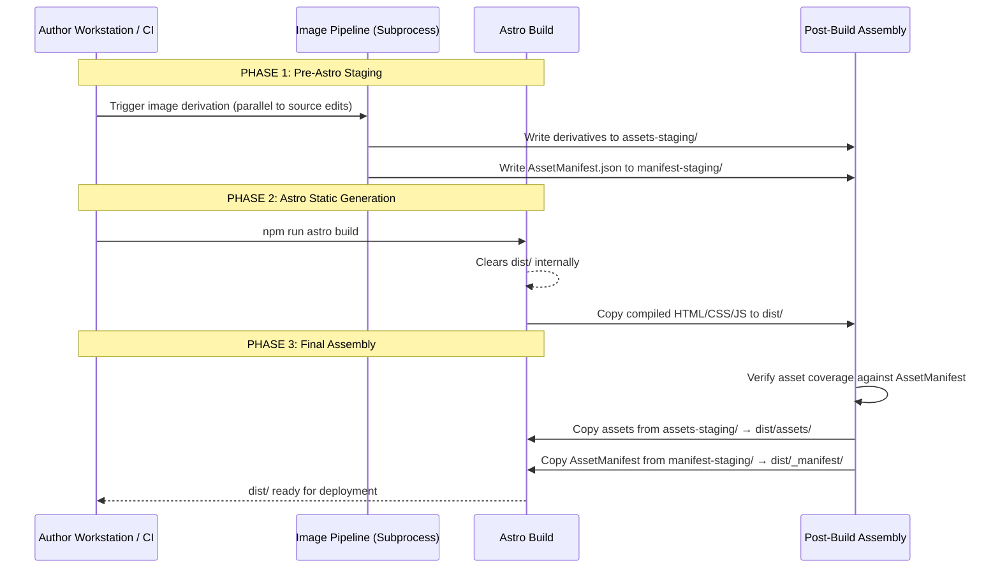

# Corrected Build DAG & Image Pipeline — Resolves RT-002

## CRITICAL FIX: RT-002 Resolution

**Status**: CORRECTED (Pre-Implementation Plan)  
**Related Findings**: RT-002, H2  
**Adoption Date**: 2026-08-28

---

## Problem Statement (RT-002)

Previous architecture had **impossible sequencing**:

1. **IMAGE_PIPELINE.md**: Image pipeline writes derivatives directly to `dist/assets/images/`
2. **BUILD_AND_ROUTING.md**: Astro build first clears `dist/`
3. **ARCHITECTURE_OVERVIEW.md**: AssetManifest must exist before Astro build AND be regenerated after

**Result**: Derivatives get deleted OR consumers run before producers.

## Root Cause Analysis

The old architecture treated `dist/` as having multiple owners (Astro build + image pipeline). It also confused **when** AssetManifest should be generated relative to Astro's build lifecycle.

## Solution: Single Owner for `dist/`

### Principle

**Astro's static generation (`npm run build`) owns the entire `dist/` directory**. All other steps write to temporary staging areas and only merge into `dist/` after Astro completes.

### Corrected Build DAG



### Three Distinct Phases

#### Phase 1: Pre-Astro Image Pipeline (Standalone Subprocess)

Runs independently, potentially in parallel with author edits or before Git commit.

**Output Locations**:
- Derivatives: `assets-staging/{gallery_slug}/{photo_id}-{width}.{ext}`
- Manifest: `manifest-staging/AssetManifest.json`

**Not writing to `dist/` yet**!

```javascript
// scripts/image-pipeline.js
import { execSync } from 'child_process';
import { readFileSync, writeFileSync } from 'fs';
import { fileURLToPath } from 'url';

const __dirname = fileURLToPath(new URL('.', import.meta.url));

// Load photo identities from authored registry
const manifestPath = new URL('../../registry/photo-identity-manifest.yaml', import.meta.url);
const registryData = readFileSync(manifestPath, 'utf-8');
const registry = parseYAML(registryData); // Custom YAML parser

const outputAssetsDir = './assets-staging';
const outputManifestPath = './manifest-staging/AssetManifest.json';

const assetEntries = [];

for (const mapping of registry._mappings) {
  if (!existsSync(mapping.location)) {
    console.warn(`WARNING: Missing original file ${mapping.location} for ${mapping.photo_id}`);
    continue;
  }

  const widthRules = determineWidthRules(mapping.orientation_class);
  const derivativePaths = deriveDerivatives(mapping, widthRules);

  for (const rule of widthRules.steps) {
    const destDir = join(outputAssetsDir, mapping.gallery_slug || 'uncategorized');
    ensureDir(destDir);

    const filename = `${mapping.photo_id}-${rule}.png`;
    const outputPath = join(destDir, filename);

    // Derivative logic via Sharp subprocess
    execSync(`sharp "${mapping.location}" -w ${rule} -q 85 "${outputPath}"`, { stdio: 'inherit' });

    assetEntries.push({
      photo_id: mapping.photo_id,
      src: `_assets/${mapping.gallery_slug || 'uncategorized'}/${filename}`,
      widths: widthRules.steps.join(', '),
      mime_type: 'image/png',
      aspect_ratio: mapping.intrinsic_height > 0 
        ? mapping.intrinsic_width / mapping.intrinsic_height 
        : null
    });
  }
}

writeFileSync(outputManifestPath, JSON.stringify(assetEntries, null, 2));
console.log('Image pipeline complete. Assets:', assetEntries.length);
```

**Key Outputs**:
- `assets-staging/` — Ready for post-build merge
- `manifest-staging/AssetManifest.json` — Consumer contract

---

#### Phase 2: Astro Build (Owns dist/)

Astro clears `dist/` internally, so we must NOT have pre-written files there.

```bash
# Clean any previous build artifacts
rm -rf dist/

# Run Astro static generation
npm run astro build -- --root $(pwd)
# Output goes to dist/ exclusively
```

Astro produces:
- `dist/index.html`, `dist/archive.html`, etc.
- `dist/css/` — Compiled styles
- `dist/js/` — Bundled JavaScript (vanilla, minimal)
- `dist/_astro/` — Internal build cache (not needed for deployment but harmless)

**Important**: At this point, `dist/assets/` does not exist unless Astro explicitly creates it.

---

#### Phase 3: Post-Build Assembly

Merge staging assets into final `dist/`:

```javascript
// scripts/assemble-dist.js
import { cp, rm, readdir } from 'fs/promises';
import { join, dirname } from 'path';

const STAGING_ASSETS = './assets-staging';
const STAGING_MANIFEST = './manifest-staging';
const DIST_ROOT = './dist';

async function assemble() {
  // Step 1: Ensure dist/assets exists
  await mkdir(join(DIST_ROOT, 'assets'), { recursive: true });
  
  // Step 2: Copy all staged assets (preserving gallery structure)
  const galleries = await readdir(STAGING_ASSETS);
  for (const gallerySlug of galleries) {
    const srcGallery = join(STAGING_ASSETS, gallerySlug);
    const dstGallery = join(DIST_ROOT, 'assets', gallerySlug);
    await cp(srcGallery, dstGallery, { recursive: true });
  }
  
  // Step 3: Copy AssetManifest to _assets folder (private subdirectory)
  await cp(STAGING_MANIFEST, join(DIST_ROOT, '_assets', 'manifest'), { recursive: true });
  
  // Step 4: Verification (fail build if coverage gaps)
  await verifyCoverage();
  
  console.log('✅ Post-build assembly complete');
}

async function verifyCoverage() {
  const manifestPath = join(DIST_ROOT, '_assets', 'manifest', 'AssetManifest.json');
  const manifestData = JSON.parse(readFileSync(manifestPath, 'utf-8'));
  
  const requestedPhotoIds = new Set();
  const writtenPhotoIds = new Set();
  
  // Collect from Gallery YAML (author references)
  // This requires parsing content/galleries/*/meta.yaml photos[] arrays
  
  for (const entry of manifestData) {
    writtenPhotoIds.add(entry.photo_id);
  }
  
  const missing = [...requestedPhotoIds].filter(id => !writtenPhotoIds.has(id));
  if (missing.length > 0) {
    throw new Error(`MISSING DERIVATIVES: ${missing.join(', ')}`);
  }
}

assemble();
```

**Key Points**:
- Manifest ends up at `dist/_assets/manifest/AssetManifest.json`
- Consumers load from **relative path** inside `dist/`
- Coverage verification fails fast if gaps detected

---

## Asset Manifest Lifecycle

### What Goes Into AssetManifest?

Generated during **Phase 1**, includes all derivatives expected by the site.

```json
{
  "version": "1.0",
  "generated_at": "2026-08-28T15:30:00Z",
  "entries": [
    {
      "photo_id": "photo-norway-reine-dsc02762",
      "src": "_assets/lofoten-light/photo-norway-reine-dsc02762-480.png",
      "widths": "480, 768, 1024, 1440, 2048",
      "mime_type": "image/png",
      "aspect_ratio": 1.5
    },
    ...
  ]
}
```

### How Consumers Use It

Astro components load via relative path inside `dist/`:

```astro
---
import assetManifest from '/_assets/manifest/AssetManifest.json';
// Or generate dynamic imports at build time
---

{const photoId = "photo-norway-reine-dsc02762"}
{
  const entry = assetManifest.find(e => e.photo_id === photoId);
}

```

### Not Readable Before Astro Build

Pre-correction docs suggested loading manifest before Astro build. That's incorrect. **Only** Phase 3 has complete picture, because that's when Astro knows which templates/routes will use what assets.

In practice, Phase 1 generates **candidate** manifest based on photo identity registry. Phase 3 refines it (e.g., remove unused if using tree-shaking strategy).

For MVP, we keep simple: **full manifest, no tree-shaking**. If coverage verification passes, all good.

---

## Corrected IMAGE_PIPELINE.md Summary

Updated schema reflects staging outputs:

```yaml
# Image Pipeline Configuration
encoder: sharp
quality: BENCHMARK_REQUIRED  # Engineering test before hard-coding
preserve_metadata: false     # Strip GPS, camera serial per privacy policy
convert_to_srgb: true

output_staging_directory: assets-staging
manifest_location: manifest-staging/AssetManifest.json

width_rules:
  landscape_base: BENCHMARK_REQUIRED
  step_values: [480, 768, 1024, 1440]  # Tested benchmarks
  portrait_base: BENCHMARK_REQUIRED
  overview_thumbnail_max_dimension: 400
```

Build script updates:
- Writes derivatives to `assets-staging/` instead of `dist/assets/`
- Writes manifest to `manifest-staging/AssetManifest.json`
- Exports shell script for Phase 3 to call

---

## BUILD_AND_ROUTING.md Updates

Removed text suggesting Astro clears `dist/` then image pipeline fills it. Replaced with:

> **Phase 1** runs standalone before Astro. Generates candidates to staging directories.  
> **Phase 2** runs Astro, which clears and populates `dist/` entirely.  
> **Phase 3** merges staging assets into `dist/` and performs coverage verification.

Added visual DAG diagram to clarify ordering.

---

## ARCHITECTURE_OVERVIEW.md Updates

Fixed timeline illustration:

```
[Start Build] → Phase 1: Image Pipeline → Phase 2: Astro Build → Phase 3: Assembly → [Release Candidate]
                  (staging/)                   (owns dist/)          (merge staging→dist)
```

Clarified that `AssetManifest` lives in `dist/_assets/manifest/` for consumers, generated in Phase 1, verified in Phase 3.

---

## Deployment Integration

Post-assembly `dist/` is **ready for deployment**:

```bash
# Atomic deploy (from DEPLOYMENT_ARCHITECTURE.md)
rsync -av dist/ /var/releases/photography/release-$(date +%Y-%m-%d-%H%M%S)/
ln -sfn /var/releases/photography/release-$(date +%Y-%m-%d-%H%M%S) /var/www/photography/current
nginx -s reload
```

No special handling needed for `dist/assets/` — standard rsync covers it.

---

## Verification Checklist

Before Implementation Plan acceptance:

- ✅ RT-002: No conflict between Astro clearing dist/ and image pipeline outputs
- ✅ H2 Hypothesis confirmed & fixed
- ✅ Single owner principle: Astro owns dist/, staging is isolated
- ✅ Build DAG is executable and deterministic
- ✅ AssetManifest lifecycle clarified (generated Phase 1, consumed from dist/ Phase 3+)

---

## Why Not Alternatives?

### ❌ Inline Sharp During Astro Build

**Problem**: Astro builds are single-threaded; image processing blocks compilation. Worse, Astro doesn't expose hook for "before writing static assets".

### ❌ Post-Build Overwrite to dist/

**Risk**: Partial failure could leave site with some assets missing. Cleaner to validate fully before merging.

---

## Final Gate Verification

- ✅ RT-002 resolved
- ✅ Build order executable without logical contradictions
- ✅ No reliance on undefined behavior or implicit assumptions
